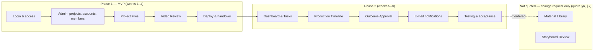

# Leap Up Client Project Portal — Requirements Proposal

A web portal where Leap Up (video production) and its clients follow one production project in one place: share files, review video at exact timecodes, track tasks, log change requests and sign off the final cut.

This repository holds the **requirements proposal**: scope, requirements specs, user flows, wireframes, use cases, user stories with acceptance criteria, diagrams, error scenarios, delivery timeline and a technical proposal. It is not the application code.

> **Status: draft for review (2026-11-22).** Everything follows the agreed quote and Miro board. Anything they do not state is marked **TBD**; anything proposed beyond them is marked **🔵 proposed**. Board names, dates and figures are sample data.

**👉 Wireframes (clickable):** open the [wireframe gallery](https://vincetruong0512.github.io/LeapUp-plan/) — served by GitHub Pages.

## Start here

| Read | What you get |
|---|---|
| [Delivery plan](docs/portal/delivery-plan.md) | Scope by phase, 8-week timeline, story order per sprint, open points by deadline |
| [Error & edge cases](docs/portal/error-edge-cases.md) | 28 scenarios where users must see an error + one error flow diagram |
| [Technical solution design](docs/portal/technical-solution-design.md) | Fixed constraints from the quote vs technical proposals |
| [Project overview](docs/portal/brainstorms/project-overview.md) | Goals, users, end-to-end MVP flow |
| [Board map](docs/portal/board-map.md) | Every Miro board column, section bar (PROJECT STATUS, PROPOSAL \| PROJECT TIMELINE, MARTERIAL ALIGNMENT, MATERIAL \| DETAIL SCRIPT & STORY BOARD, OUTCOME REVIEW, OUTCOME APPROVAL) and screen → where it is documented; 479/479 board lines covered |

## Scope at a glance

**Not quoted:** Material Library and Storyboard Review are designed on the board and fully documented here (tagged **OUT**), but they need a separate change request. Also excluded: in-app notifications, realtime updates, multi-company SaaS.

## Documents per feature

| Phase | Feature | Spec | User flow | Wireframes | Use cases | Diagrams | Stories |
|---|---|---|---|---|---|---|---|
| MVP | Login & access | [spec](docs/auth-access/srs/auth-access-spec.md) | [flow](docs/auth-access/srs/auth-access-userflow.md) | [HTML](docs/auth-access/html-wireframe/auth-access-wireframe.html) | [UCs](docs/auth-access/usecases/auth-access-usecase-index.md) | [flows](docs/auth-access/srs/auth-access-flows.md) | [stories](docs/auth-access/userstories/auth-access-story-index.md) |
| MVP | Admin | [spec](docs/admin/srs/admin-spec.md) | [flow](docs/admin/srs/admin-userflow.md) | not drawn (no board design) | [UCs](docs/admin/usecases/admin-usecase-index.md) | [flows](docs/admin/srs/admin-flows.md) | [stories](docs/admin/userstories/admin-story-index.md) |
| MVP | Project Files | [spec](docs/project-files/srs/project-files-spec.md) | [flow](docs/project-files/srs/project-files-userflow.md) | [HTML](docs/project-files/html-wireframe/project-files-wireframe.html) | [UCs](docs/project-files/usecases/project-files-usecase-index.md) | [flows](docs/project-files/srs/project-files-flows.md) | [stories](docs/project-files/userstories/project-files-story-index.md) |
| MVP | Video Review | [spec](docs/video-review/srs/video-review-spec.md) | [flow](docs/video-review/srs/video-review-userflow.md) | [HTML](docs/video-review/html-wireframe/video-review-wireframe.html) | [UCs](docs/video-review/usecases/video-review-usecase-index.md) | [flows](docs/video-review/srs/video-review-flows.md) | [stories](docs/video-review/userstories/video-review-story-index.md) |
| P2 | Dashboard & Tasks | [spec](docs/dashboard-tasks/srs/dashboard-tasks-spec.md) | [flow](docs/dashboard-tasks/srs/dashboard-tasks-userflow.md) | [HTML](docs/dashboard-tasks/html-wireframe/dashboard-tasks-wireframe.html) | [UCs](docs/dashboard-tasks/usecases/dashboard-tasks-usecase-index.md) | [flows](docs/dashboard-tasks/srs/dashboard-tasks-flows.md) | [stories](docs/dashboard-tasks/userstories/dashboard-tasks-story-index.md) |
| P2 | Production Timeline | [spec](docs/production-timeline/srs/production-timeline-spec.md) | [flow](docs/production-timeline/srs/production-timeline-userflow.md) | [HTML](docs/production-timeline/html-wireframe/production-timeline-wireframe.html) | [UCs](docs/production-timeline/usecases/production-timeline-usecase-index.md) | [flows](docs/production-timeline/srs/production-timeline-flows.md) | [stories](docs/production-timeline/userstories/production-timeline-story-index.md) |
| P2 | Outcome Approval | [spec](docs/outcome-approval/srs/outcome-approval-spec.md) | [flow](docs/outcome-approval/srs/outcome-approval-userflow.md) | [HTML](docs/outcome-approval/html-wireframe/outcome-approval-wireframe.html) | [UCs](docs/outcome-approval/usecases/outcome-approval-usecase-index.md) | [flows](docs/outcome-approval/srs/outcome-approval-flows.md) | [stories](docs/outcome-approval/userstories/outcome-approval-story-index.md) |
| P2 | E-mail notifications | [spec](docs/email-notifications/srs/email-notifications-spec.md) | [flow](docs/email-notifications/srs/email-notifications-userflow.md) | no UI | [UCs](docs/email-notifications/usecases/email-notifications-usecase-index.md) | [flows](docs/email-notifications/srs/email-notifications-flows.md) | [stories](docs/email-notifications/userstories/email-notifications-story-index.md) |
| OUT | Material Library | [spec](docs/material-library/srs/material-library-spec.md) | [flow](docs/material-library/srs/material-library-userflow.md) | [HTML](docs/material-library/html-wireframe/material-library-wireframe.html) | [UCs](docs/material-library/usecases/material-library-usecase-index.md) | [flows](docs/material-library/srs/material-library-flows.md) | [stories](docs/material-library/userstories/material-library-story-index.md) |
| OUT | Storyboard Review | [spec](docs/storyboard-review/srs/storyboard-review-spec.md) | [flow](docs/storyboard-review/srs/storyboard-review-userflow.md) | [HTML](docs/storyboard-review/html-wireframe/storyboard-review-wireframe.html) | [UCs](docs/storyboard-review/usecases/storyboard-review-usecase-index.md) | [flows](docs/storyboard-review/srs/storyboard-review-flows.md) | [stories](docs/storyboard-review/userstories/storyboard-review-story-index.md) |

Brainstorms (background and open points) are in `docs/{feature}/brainstorms/`. Jira import drafts are in [docs/exports](docs/exports/).

**Totals:** 10 features (8 quoted + 2 OUT) · 110 functional requirements · 33 error codes · 23 use cases · 23 diagrams · 37 user stories · 82 acceptance criteria (drafts) · 29 wireframe screens. Quoted scope only: 84 FR · 25 errors · 19 use cases · 30 stories · 65 AC · 20 screens.

## How to read the markers

| Marker | Meaning |
|---|---|
| `Lnnn` | Line of the Miro board text export the item comes from |
| `quote P1 #2`, `§5` | Section of the agreed quote |
| **TBD** / `OQ-n` | Not stated in the reference — open question for Leap Up |
| **OPEN C1–C9** | Difference between quote and board, to be decided |
| 🔵 proposed | Suggestion beyond the reference, not agreed |

**HTML wireframes:** GitHub shows `.html` files as source code. Use the gallery link above, or download the repository and open `docs/{feature}/html-wireframe/{feature}-wireframe.html` in a browser.
