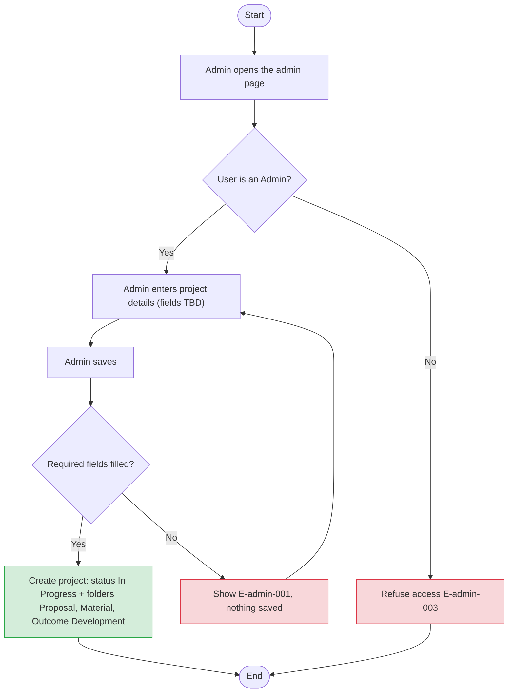
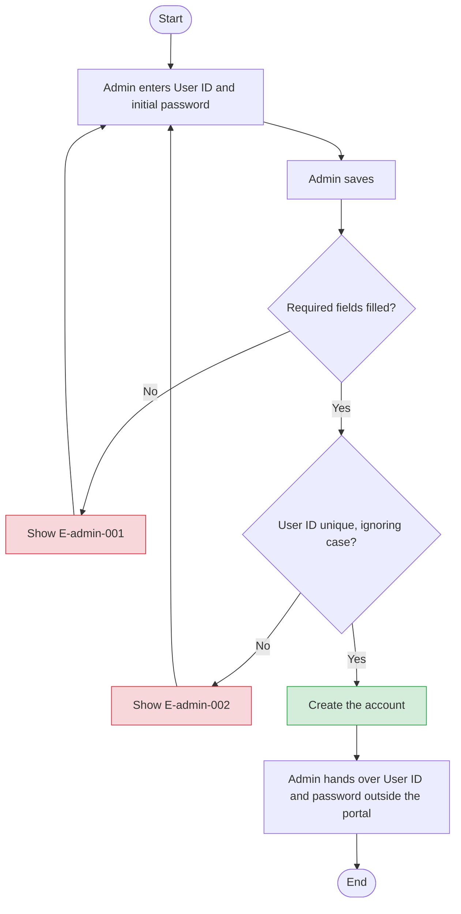
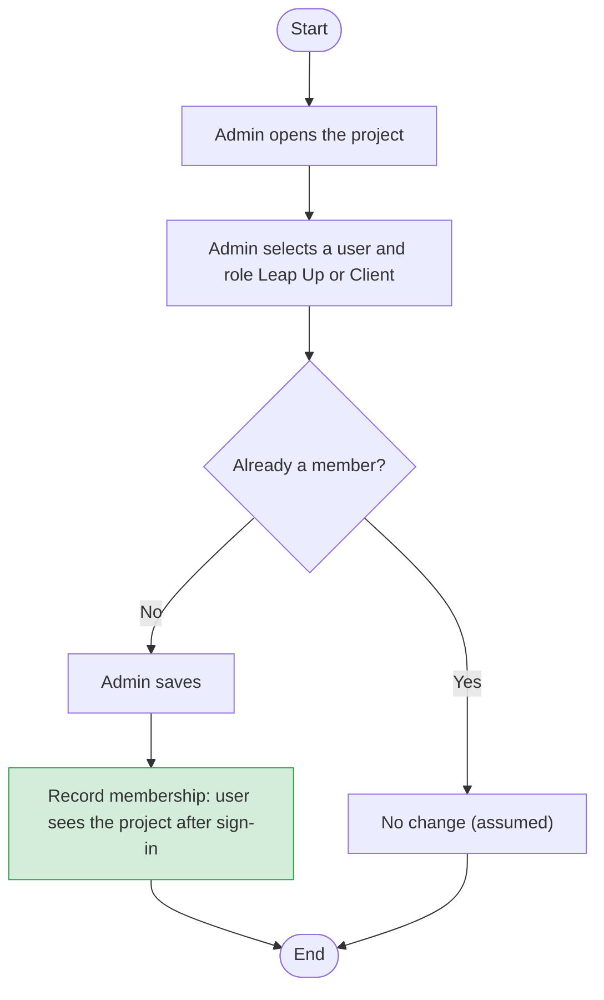

# Admin — Flows

## Flow: Create a project (Activity)

**Trigger**: Admin opens the admin page to create a project.
**Related UC**: [UC-admin-01](../usecases/uc-create-project.md)
**Related FR**: FR-admin-001, FR-admin-002, FR-admin-003, FR-admin-004, FR-admin-008
**Related E**: E-admin-001, E-admin-003

## Flow: Create a client account (Activity)

**Trigger**: Admin saves a new client account.
**Related UC**: [UC-admin-02](../usecases/uc-create-client-account.md)
**Related FR**: FR-admin-005, FR-admin-006, FR-admin-008
**Related E**: E-admin-001, E-admin-002

## Flow: Assign members to a project (Activity)

**Trigger**: Admin adds a user to a project.
**Related UC**: [UC-admin-03](../usecases/uc-assign-members.md)
**Related FR**: FR-admin-007
**Related E**: —

