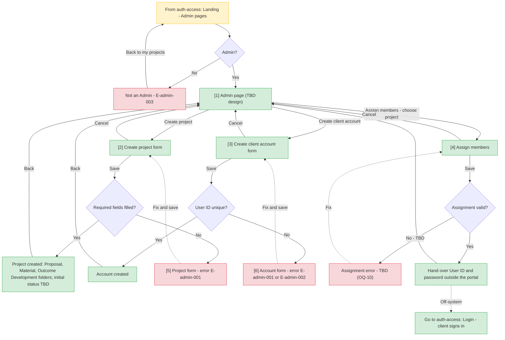

# admin — User Flow

Screens are not on the board (C3); names below are placeholders for flow tracing only, not designs.

Revised 2026-11-22 after the MVP review ([review-2026-11-22-mvp.md](../../portal/review-2026-11-22-mvp.md), R-01, R-05):
not-an-admin gate, Cancel on every form, errors return to the failing form, the three actions are independent (order TBD,
OQ-11), folders created on save, off-system hand-over of login details. Needs re-approval.

## 1. User Flow (overall)

Order of the three actions: not set by the quote or board; drawn as independent actions from the admin page
(OQ-11). Proposal PR3 (one wizard) is undecided. Password reset (BR-auth-access-004) and remove member / deactivate
(OQ-5, OQ-6) have no flow until Leap Up answers.

## 2. Screens

| [#] | Slug | Screen | Purpose | Flow | Board |
|-----|------|--------|---------|------|-------|
| 1 | admin-home | Admin page | Entry to admin tasks | setup | none (C3) |
| 2 | project-form | Create project | Project details (fields TBD, OQ-3) | setup | none |
| 3 | account-form | Create client account | User ID + password | setup | none |
| 4 | members | Assign members | Choose project, add users with role Leap Up / Client | setup | none |
| 5 | project-form-error | Project form — error | E-admin-001 | setup | none |
| 6 | account-form-error | Account form — error | E-admin-001 / 002 | setup | none |
| — | not-admin | Not an Admin | E-admin-003 (shares the auth-access refusal state) | setup | none |

## 3. Flows

| Flow-slug | Flow name | Screens | Cases covered |
|-----------|-----------|---------|---------------|
| setup | Set up a project and its access | 1–6 | happy 1→2→1, 1→3→1, 1→4→hand-over · error 5, 6, not-admin, assignment error (TBD) · cancel on 2, 3, 4 |

## 3.5. Transitions

| From [#] | To [#] | Trigger | Condition |
|----------|--------|---------|-----------|
| auth-access landing | 1 | Admin pages | Admin; otherwise E-admin-003 |
| 1 | 2 | Create project | — |
| 2 | 1 | Save | Required fields filled; folders created; initial status TBD |
| 2 | 5 | Save | Required field empty (E-admin-001) |
| 5 | 2 | Fix and save | Input kept (TBD) |
| 1 | 3 | Create client account | — |
| 3 | 1 | Save | User ID unique |
| 3 | 6 | Save | Field empty (E-admin-001) or User ID taken (E-admin-002) |
| 6 | 3 | Fix and save | — |
| 1 | 4 | Assign members | Project chosen in the form |
| 4 | hand-over | Save | Assignment valid |
| 4 | assignment error | Save | TBD (OQ-10) |
| 2, 3, 4 | 1 | Cancel | Nothing saved |
| hand-over | auth-access [1] | Client signs in | Outside the portal |

## 4. Open Questions

- [ ] OQ-1 (C3): All admin screens need a design before `/wireframe-html` can draw them.
- [ ] OQ-2: Order of actions and admin entry point (spec OQ-11).
- [ ] OQ-3: Assignment error branch (spec OQ-10).
- [ ] OQ-4: Password reset, remove member, deactivate — no flow yet (spec OQ-5, OQ-6).
