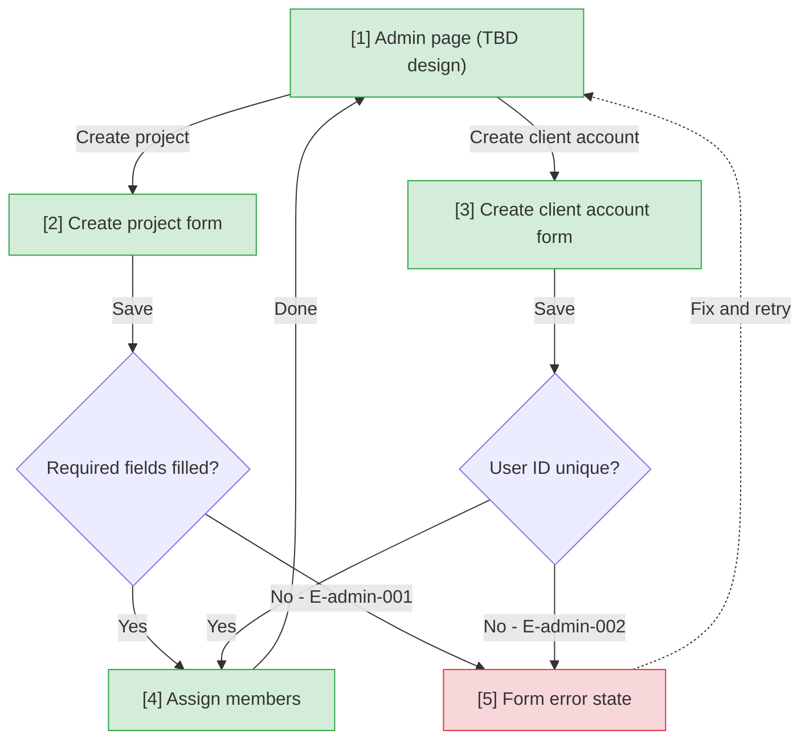

# admin — User Flow

Screens are not on the board (C3); names below are placeholders for flow tracing only, not designs.

## 1. User Flow (overall)

## 2. Screens

| [#] | Slug | Screen | Purpose | Flow | Board |
|-----|------|--------|---------|------|-------|
| 1 | admin-home | Admin page | Entry to admin tasks | setup | none (C3) |
| 2 | project-form | Create project | Project details | setup | none |
| 3 | account-form | Create client account | User ID + password | setup | none |
| 4 | members | Assign members | Add users with role Leap Up / Client | setup | none |
| 5 | form-error | Form error state | E-admin-001 / 002 | setup | none |

## 3. Flows

| Flow-slug | Flow name | Screens | Cases covered |
|-----------|-----------|---------|---------------|
| setup | Set up a project and its access | 1–5 | happy 1→2→4, 1→3→4 · error 5 |

## 3.5. Transitions

| From [#] | To [#] | Trigger | Condition |
|----------|--------|---------|-----------|
| 1 | 2 | Create project | Admin |
| 2 | 4 | Save | Required fields filled |
| 1 | 3 | Create client account | Admin |
| 3 | 4 | Save | User ID unique |
| 2, 3 | 5 | Save | Validation fails |
| 4 | 1 | Done | — |

## 4. Open Questions

- [ ] OQ-1 (C3): All admin screens need a design before `/wireframe-html` can draw them.
