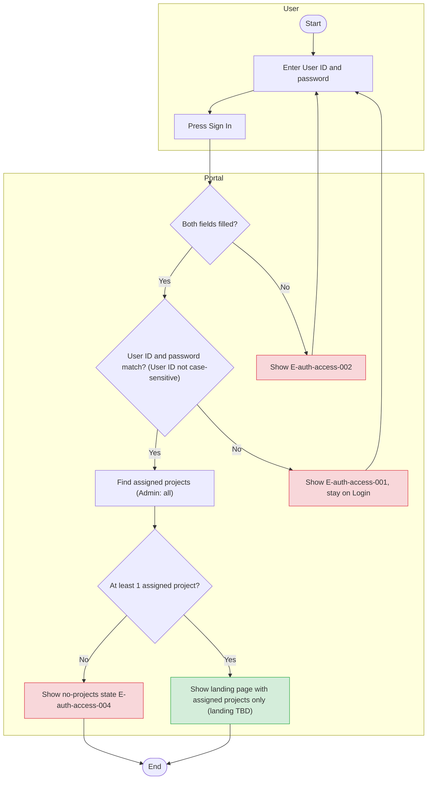
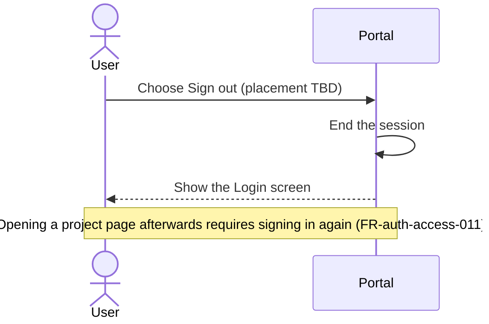

# Login & Project Access — Flows

## Flow: Sign in to my projects (Activity)

**Trigger**: User presses "Sign In" on the Login screen.
**Related UC**: [UC-auth-access-01](../usecases/uc-sign-in-to-my-projects.md)
**Related FR**: FR-auth-access-001, FR-auth-access-002, FR-auth-access-003, FR-auth-access-004, FR-auth-access-005, FR-auth-access-006, FR-auth-access-007, FR-auth-access-008, FR-auth-access-009, FR-auth-access-010
**Related E**: E-auth-access-001, E-auth-access-002, E-auth-access-003, E-auth-access-004

## Flow: Sign out (Sequence)

**Trigger**: User chooses Sign out.
**Related UC**: [UC-auth-access-02](../usecases/uc-sign-out.md)
**Related FR**: FR-auth-access-011
**Related E**: —

