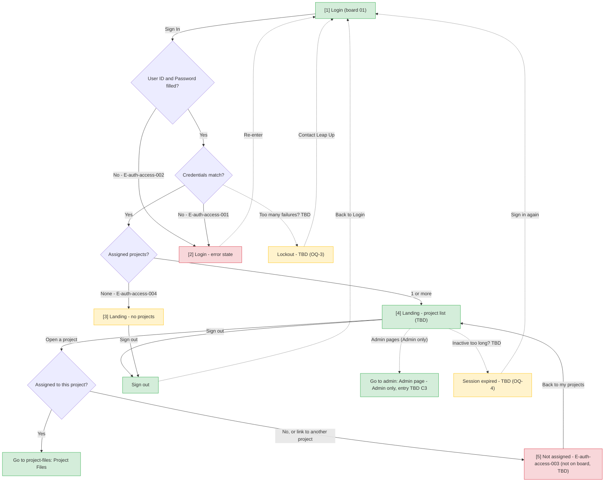

# auth-access — User Flow

Revised 2026-11-22 after the MVP review ([review-2026-11-22-mvp.md](../../portal/review-2026-11-22-mvp.md), R-01, R-03, R-17):
not-assigned branch, hand-offs to project-files and admin, TBD stubs for lockout and session expiry. Needs re-approval.

## 1. User Flow (overall)

The access check d4 runs on every request, not only from the landing page: a copied link, a file download, a video
or a comment of a project the user isn't assigned to all end in [5] (FR-auth-access-009). project-files, video-review
and admin show the same branch and point here. A signed-out request goes to [1] Login.

Not drawn as flow (display only): masked password with Show (FR-auth-access-002, board L79, L89–L90), the access
note box (board L150–L170).

## 2. Screens

| [#] | Slug | Screen | Purpose | Flow | Board |
|-----|------|--------|---------|------|-------|
| 1 | login | Login | Enter User ID + password | sign-in | 01, L18–L170 |
| 2 | login-error | Login — error state | Show E-auth-access-001/002 (wording, position TBD — spec OQ-13) | sign-in | not drawn |
| 3 | landing-empty | Landing — no projects | Signed in, no assigned project (E-auth-access-004) | sign-in | not drawn |
| 4 | landing | Landing — project list | Assigned projects; page TBD (spec OQ-1) | sign-in | not drawn |
| 5 | not-assigned | Not assigned | Refusal, no project content (E-auth-access-003, wording TBD) | sign-in | not drawn |

## 3. Flows

| Flow-slug | Flow name | Screens | Cases covered |
|-----------|-----------|---------|---------------|
| sign-in | Sign in, open a project, sign out | 1, 2, 3, 4, 5 | happy: 1→4→project-files · error: 2, 5 · edge: 3, lockout/expiry TBD · sign out → 1 |

## 3.5. Transitions

| From [#] | To [#] | Trigger | Condition |
|----------|--------|---------|-----------|
| 1 | 4 | Sign In | Fields filled, credentials match, ≥ 1 assigned project |
| 1 | 2 | Sign In | Empty field (E-auth-access-002) or wrong credentials (E-auth-access-001) |
| 2 | 1 | Edit fields | — |
| 1 | 3 | Sign In | Credentials match, no assigned project |
| 4 | project-files [1] | Open a project | User is assigned to the project |
| 4 or any link | 5 | Open a project / file / video / comment | User is not assigned (E-auth-access-003) |
| 5 | 4 | Back to my projects | — |
| 4 | admin [1] | Admin pages | Admin only; entry placement TBD (C3, admin OQ-1) |
| 3, 4 | 1 | Sign out | Placement TBD |

## 4. Open Questions

- [ ] OQ-1: Landing page content (spec OQ-1).
- [ ] OQ-2: Sign-out placement (spec OQ-2).
- [ ] OQ-3: Lockout branch — drawn as a TBD stub; keep only if Leap Up decides one (spec OQ-3).
- [ ] OQ-4: Session-expired branch — drawn as a TBD stub (spec OQ-4).
- [ ] OQ-5: Phone layout of the flow's screens (spec OQ-5).
- [ ] OQ-6: Access note says one User ID per project (board L159) vs one per person (spec BR-auth-access-003, OQ-9).
- [ ] OQ-7: Already signed-in user opening Login (spec OQ-14).
