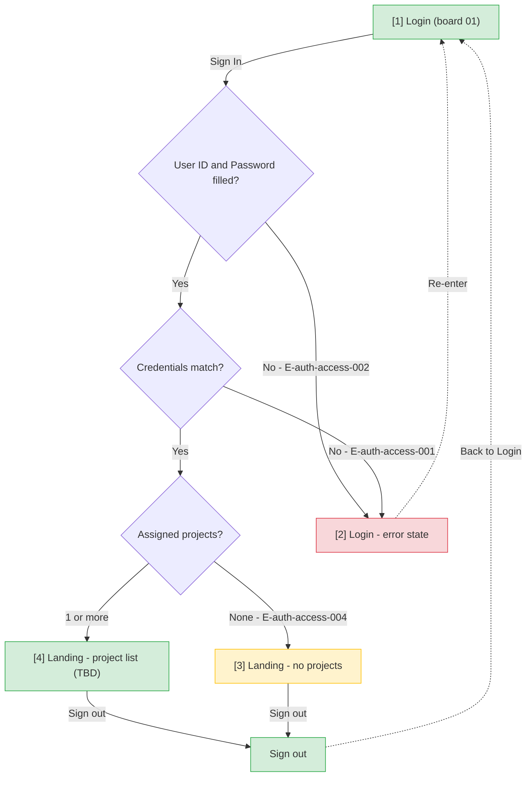

# auth-access — User Flow

## 1. User Flow (overall)

## 2. Screens

| [#] | Slug | Screen | Purpose | Flow | Board |
|-----|------|--------|---------|------|-------|
| 1 | login | Login | Enter User ID + password | sign-in | 01, L18–L170 |
| 2 | login-error | Login — error state | Show E-auth-access-001/002 (wording TBD) | sign-in | not drawn |
| 3 | landing-empty | Landing — no projects | Signed in, no assigned project (E-auth-access-004) | sign-in | not drawn |
| 4 | landing | Landing — project list | Assigned projects; page TBD (spec OQ-1) | sign-in | not drawn |

## 3. Flows

| Flow-slug | Flow name | Screens | Cases covered |
|-----------|-----------|---------|---------------|
| sign-in | Sign in and sign out | 1, 2, 3, 4 | happy: 1→4 · error: 2 · edge: 3 · sign out → 1 |

## 3.5. Transitions

| From [#] | To [#] | Trigger | Condition |
|----------|--------|---------|-----------|
| 1 | 4 | Sign In | Fields filled, credentials match, ≥ 1 assigned project |
| 1 | 2 | Sign In | Empty field (E-auth-access-002) or wrong credentials (E-auth-access-001) |
| 2 | 1 | Edit fields | — |
| 1 | 3 | Sign In | Credentials match, no assigned project |
| 3, 4 | 1 | Sign out | Placement TBD |

## 4. Open Questions

- [ ] OQ-1: Landing page content (spec OQ-1).
- [ ] OQ-2: Sign-out placement (spec OQ-2).
- [ ] OQ-3: Lockout branch — add only if Leap Up decides one (spec OQ-3).
- [ ] OQ-4: Session-expired branch (spec OQ-4).
