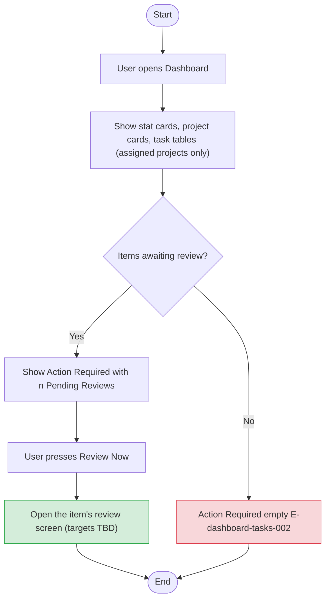
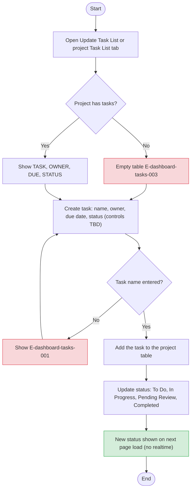

# Dashboard & Task List — Flows

## Flow: Check the overview and act on Action Required (Activity)

**Trigger**: User opens Dashboard.
**Related UC**: [UC-dashboard-tasks-01](../usecases/uc-check-overview-and-act.md)
**Related FR**: FR-dashboard-tasks-001, FR-dashboard-tasks-002, FR-dashboard-tasks-003, FR-dashboard-tasks-004, FR-dashboard-tasks-009, FR-dashboard-tasks-010, FR-dashboard-tasks-011
**Related E**: E-dashboard-tasks-002

## Flow: Manage a project's tasks (Activity)

**Trigger**: Member opens Update Task List.
**Related UC**: [UC-dashboard-tasks-02](../usecases/uc-manage-project-tasks.md)
**Related FR**: FR-dashboard-tasks-004, FR-dashboard-tasks-005, FR-dashboard-tasks-006, FR-dashboard-tasks-007, FR-dashboard-tasks-008
**Related E**: E-dashboard-tasks-001, E-dashboard-tasks-003

