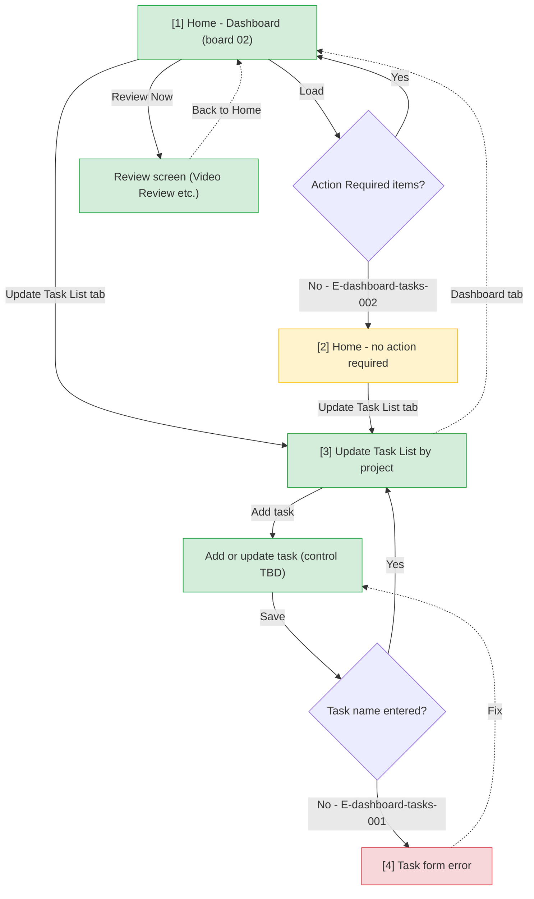

# dashboard-tasks — User Flow

## 1. User Flow (overall)

## 2. Screens

| [#] | Slug | Screen | Purpose | Flow | Board |
|-----|------|--------|---------|------|-------|
| 1 | home | Home — Dashboard, Project Management, Action Required | Overview | overview | 02, L8–L74, L194–L231 |
| 2 | home-empty | No action required | E-dashboard-tasks-002 | overview | not drawn |
| 3 | task-list | Update Task List / By Project | Task tables | tasks | 02, L82–L186 |
| 4 | task-error | Task form error | E-dashboard-tasks-001 | tasks | not drawn |

## 3. Flows

| Flow-slug | Flow name | Screens | Cases covered |
|-----------|-----------|---------|---------------|
| overview | Project overview and Action Required | 1, 2 | happy 1 · edge 2 |
| tasks | Manage tasks by project | 3, 4 | happy 3 · error 4 |

## 3.5. Transitions

| From [#] | To [#] | Trigger | Condition |
|----------|--------|---------|-----------|
| 1 | review | Review Now | Item target (OQ-3) |
| 1 | 3 | Update Task List tab | — |
| 3 | 3 | Save task | Name entered |
| 3 | 4 | Save task | Name empty |

## 4. Open Questions

- [ ] OQ-1: Task create/edit controls not drawn (spec OQ-8).
