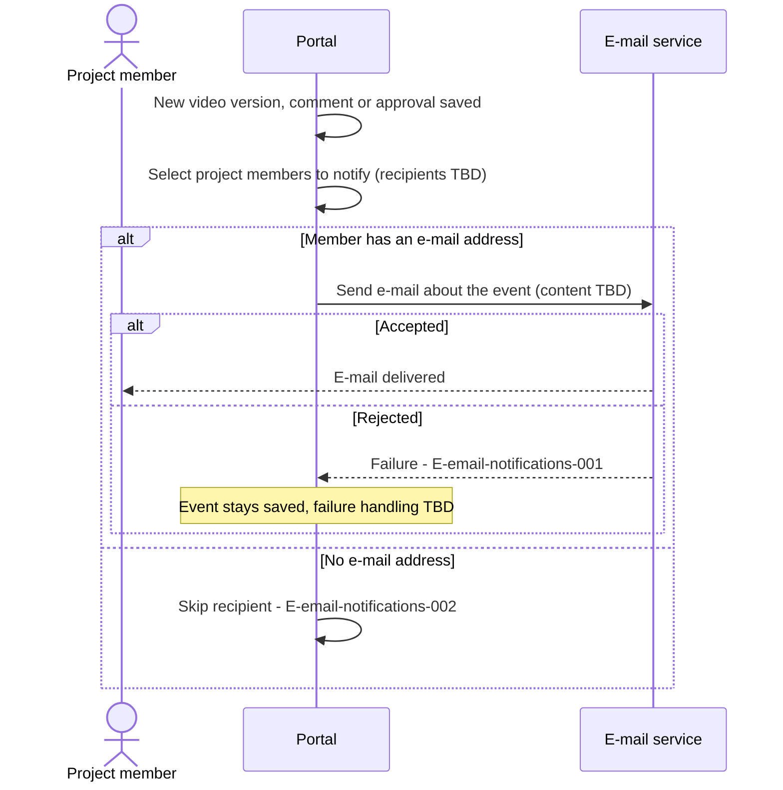

# E-mail Notifications — Flows

## Flow: Notify project members by e-mail (Sequence)

**Trigger**: New video version, comment or approval saved in a project.
**Related UC**: [UC-email-notifications-01](../usecases/uc-notify-project-members-by-email.md)
**Related FR**: FR-email-notifications-001, FR-email-notifications-002, FR-email-notifications-003, FR-email-notifications-004, FR-email-notifications-005
**Related E**: E-email-notifications-001, E-email-notifications-002

