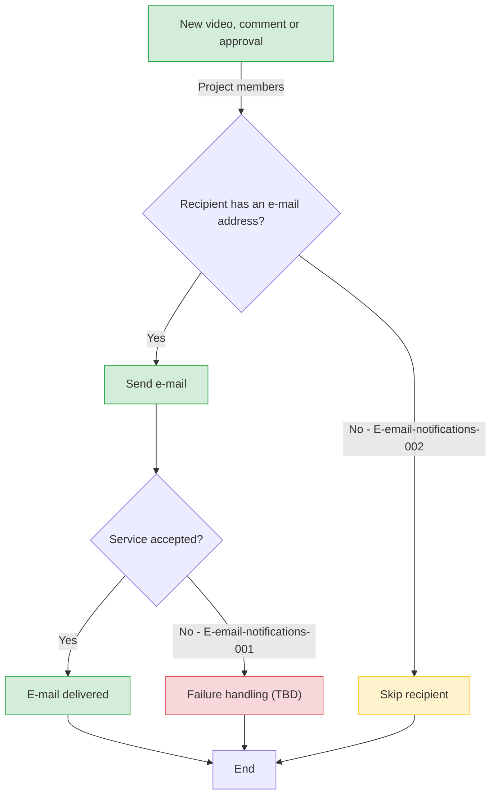

# email-notifications — User Flow

No portal screens: the flow shows the event-to-mail path. No wireframes (step 4 not applicable).

## 1. User Flow (overall)

## 2. Screens

None (e-mail only).

## 3. Flows

| Flow-slug | Flow name | Screens | Cases covered |
|-----------|-----------|---------|---------------|
| notify | Send notification e-mails | — | happy send · edge no address · error send failed |

## 3.5. Transitions

| From | To | Trigger | Condition |
|------|----|---------|-----------|
| event | send | Event | Recipient has address |
| send | failure | Service error | — |

## 4. Open Questions

- [ ] OQ-1: Link in the e-mail and where it lands (spec OQ-3).
