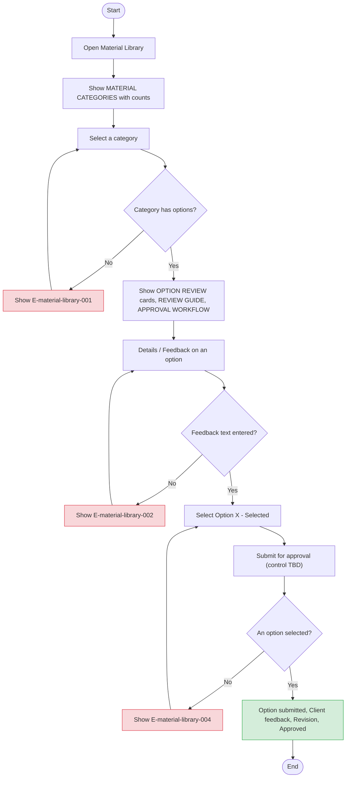
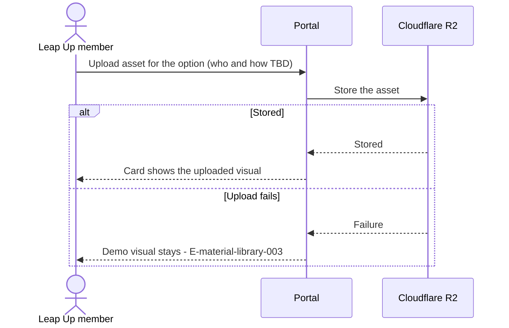

# Material Library — Flows

## Flow: Choose a material direction (OUT) (Activity)

**Trigger**: Client opens Material Library.
**Related UC**: [UC-material-library-01](../usecases/uc-choose-a-material-direction.md)
**Related FR**: FR-material-library-001, FR-material-library-002, FR-material-library-003, FR-material-library-004, FR-material-library-005, FR-material-library-006, FR-material-library-007, FR-material-library-009, FR-material-library-010, FR-material-library-011, FR-material-library-012, FR-material-library-013, FR-material-library-014
**Related E**: E-material-library-001, E-material-library-002, E-material-library-004

## Flow: Provide option visuals (OUT) (Sequence)

**Trigger**: Leap Up uploads an asset for an option.
**Related UC**: [UC-material-library-02](../usecases/uc-provide-option-visuals.md)
**Related FR**: FR-material-library-008
**Related E**: E-material-library-003

