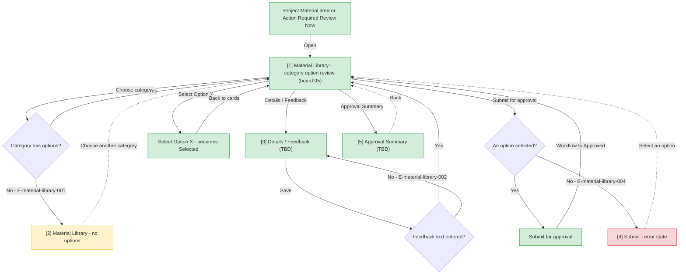

# material-library — User Flow

## 1. User Flow (overall)

## 2. Screens

| [#] | Slug | Screen | Purpose | Flow | Board |
|-----|------|--------|---------|------|-------|
| 1 | material-library | Material Library | Categories, option cards, review guide, workflow | options | 05, L366–L424 |
| 2 | material-library-empty | No options | E-material-library-001 | options | not drawn |
| 3 | option-feedback | Details / Feedback | Feedback per option | options | link only (L394) |
| 4 | submit-error | Submit — error | E-material-library-004 | options | not drawn |
| 5 | approval-summary | Approval Summary | Summary (TBD) | options | button only (L370) |

## 3. Flows

| Flow-slug | Flow name | Screens | Cases covered |
|-----------|-----------|---------|---------------|
| options | Review material options and choose a direction | 1–5 | happy 1→3→1, select, submit · edge 2 · error 4 |

## 3.5. Transitions

| From [#] | To [#] | Trigger | Condition |
|----------|--------|---------|-----------|
| entry | 1 | Open | Member |
| 1 | 2 | Choose category | No options |
| 1 | 3 | Details / Feedback | — |
| 3 | 1 | Save | Text entered |
| 1 | 1 | Select Option X | — |
| 1 | 4 | Submit for approval | Nothing selected |
| 1 | 5 | Approval Summary | — |

## 4. Open Questions

- [ ] OQ-1: Details / Feedback and Approval Summary screens are not drawn (spec OQ-4, OQ-6).
