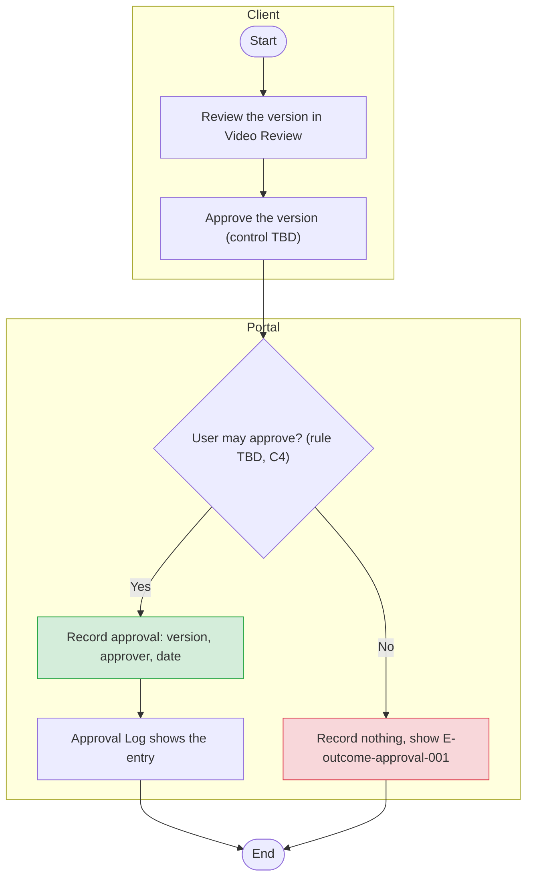
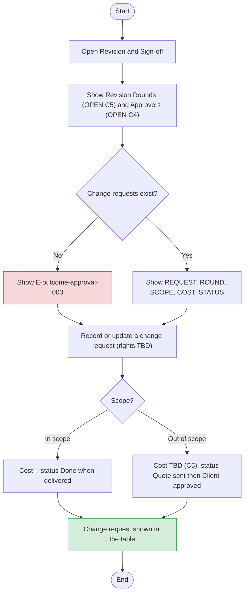
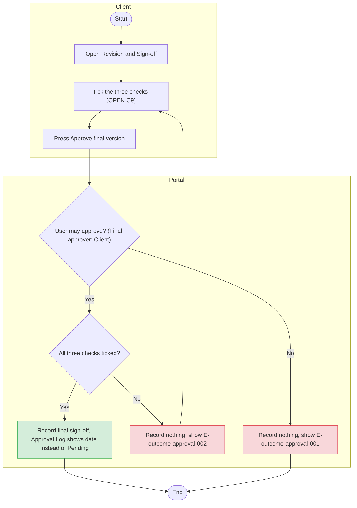

# Outcome Approval — Flows

## Flow: Approve a version (Activity)

**Trigger**: Round awaits client approval.
**Related UC**: [UC-outcome-approval-01](../usecases/uc-approve-a-version.md)
**Related FR**: FR-outcome-approval-002, FR-outcome-approval-005, FR-outcome-approval-010, FR-outcome-approval-011
**Related E**: E-outcome-approval-001

## Flow: Track change requests and revision rounds (Activity)

**Trigger**: Member opens Revision & Sign-off.
**Related UC**: [UC-outcome-approval-02](../usecases/uc-track-change-requests.md)
**Related FR**: FR-outcome-approval-001, FR-outcome-approval-003, FR-outcome-approval-004, FR-outcome-approval-008, FR-outcome-approval-009
**Related E**: E-outcome-approval-003

## Flow: Sign off the final version (Activity)

**Trigger**: Client presses "Approve final version".
**Related UC**: [UC-outcome-approval-03](../usecases/uc-sign-off-the-final-version.md)
**Related FR**: FR-outcome-approval-005, FR-outcome-approval-006, FR-outcome-approval-007, FR-outcome-approval-010
**Related E**: E-outcome-approval-001, E-outcome-approval-002

