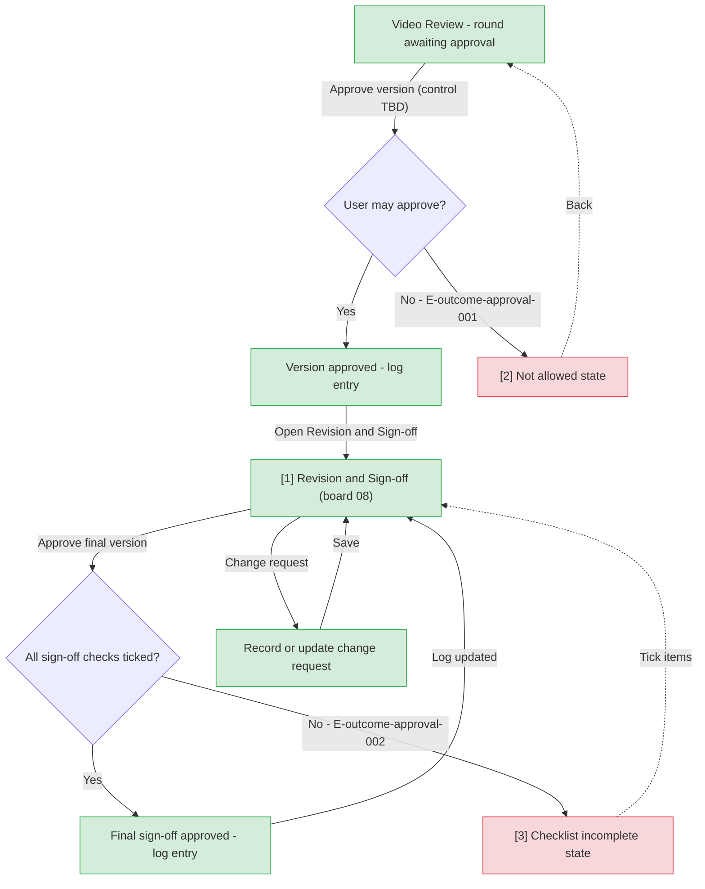

# outcome-approval — User Flow

## 1. User Flow (overall)

## 2. Screens

| [#] | Slug | Screen | Purpose | Flow | Board |
|-----|------|--------|---------|------|-------|
| 1 | revision-signoff | Revision & Sign-off | Rounds, approvers, CRs, sign-off, log | approval | 08, L214–L365 |
| 2 | approval-not-allowed | Not allowed state | E-outcome-approval-001 | approval | not drawn |
| 3 | signoff-incomplete | Checklist incomplete state | E-outcome-approval-002 | approval | not drawn |

## 3. Flows

| Flow-slug | Flow name | Screens | Cases covered |
|-----------|-----------|---------|---------------|
| approval | Approve versions, track change requests, sign off | 1, 2, 3 | happy 1 · error 2, 3 |

## 3.5. Transitions

| From [#] | To [#] | Trigger | Condition |
|----------|--------|---------|-----------|
| video-review | log | Approve version | Allowed approver (OQ-2) |
| 1 | 1 | Approve final version | All checks ticked (C9) |
| 1 | 3 | Approve final version | Checks missing |
| 1 | 1 | Save change request | Rights TBD (OQ-3) |

## 4. Open Questions

- [ ] OQ-1: Version-approval control not drawn (spec OQ-1).
