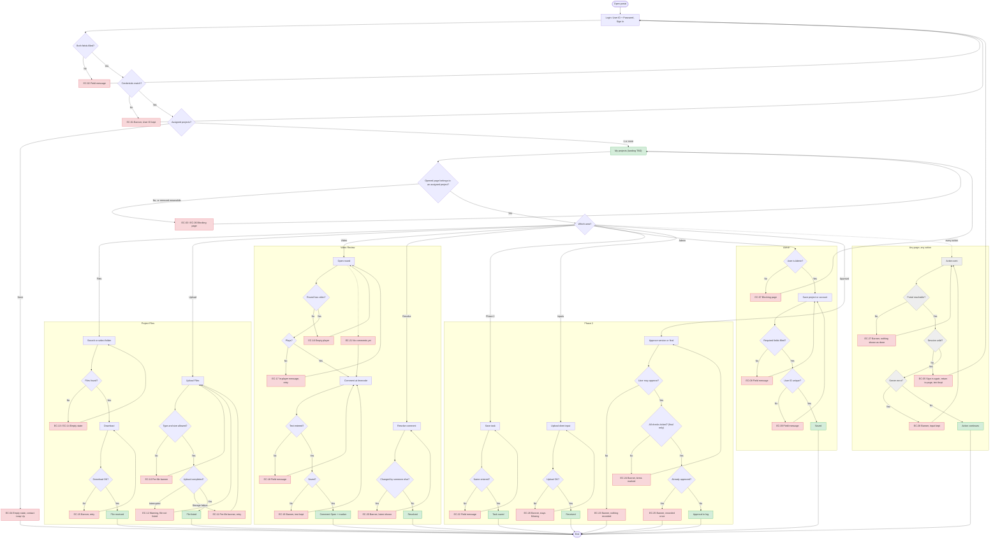

# Critical Error & Edge-Case Scenarios

Scenarios where the portal **must** show the user an error. **Source:** 🟢 *documented* = error code already in a spec's Error Matrix (wording there is TBD) · 🔵 *proposed* = assumption, not in the quote or board — for Leap Up to confirm before it enters a spec. **All wording below is proposed** (the reference gives none).

## 1. What makes a scenario critical

| Criterion | Why it matters | Examples |
|---|---|---|
| **C1 Data exposure** | A client must never see another client's content (board L146, L170) | EC-03, EC-06 |
| **C2 Data loss** | User work disappears without warning | EC-05, EC-12, EC-19 |
| **C3 False success** | User believes something happened that didn't | EC-11, EC-25, EC-26 |
| **C4 Blocked task** | User cannot continue and doesn't know why | EC-01, EC-04, EC-17 |
| **C5 Record integrity** | Approvals have contractual weight (quote P2 #3) | EC-23, EC-24, EC-25 |

## 2. How errors are displayed (🔵 proposed pattern)

| Type | Where | Used for |
|---|---|---|
| **Field message** | Under the field, field outlined | Missing/invalid input |
| **Form banner** | Top of the form or panel | Action failed after submit |
| **Empty state** | In place of the list/table/player | Nothing to show |
| **Blocking page** | Replaces page content; no project data rendered | Access refused, session expired |
| **In-player message** | Inside the video frame | Playback problems |

Rules (🔵 proposed): never show success before the action is confirmed · keep what the user typed (except the password) · every error offers a next step (retry, go back, contact Leap Up) · never reveal whether a User ID or project exists.

## 3. Scenarios

### A. Sign-in, access and session

| ID | Scenario | Code | Source | Crit. | Display | Proposed wording | Proposed behaviour |
|---|---|---|---|---|---|---|---|
| EC-01 | Wrong User ID or password | E-auth-access-001 | 🟢 | C4 | Form banner | "User ID or password is incorrect." | Keep User ID, clear password; same text for both cases |
| EC-02 | Sign In with an empty field | E-auth-access-002 | 🟢 | — | Field message | "Enter your User ID." / "Enter your password." | No check sent |
| EC-03 | Link to a project/file/video the user isn't assigned to | E-auth-access-003 | 🟢 | **C1** | Blocking page | "You don't have access to this page." | No project name or data in page or tab title; button "Go to my projects" |
| EC-04 | Signed in, no assigned project | E-auth-access-004 | 🟢 | C4 | Empty state | "No projects are assigned to you yet. Please contact Leap Up." | Sign out still available |
| EC-05 | Session expires during an action (typing a comment, uploading) | P-session-expired | 🔵 (auth-access OQ-4) | **C2** | Blocking page → Login | "Your session has ended. Sign in again to continue." | After sign-in return to the same page; unsent comment text kept |
| EC-06 | User removed from a project while viewing it | E-auth-access-003 | 🟢 (auth-access OQ-19) | **C1** | Blocking page | as EC-03 | Applied on the next action |
| EC-07 | Non-admin opens the admin page | E-admin-003 | 🟢 | C1 | Blocking page | as EC-03 | — |

### B. Admin

| ID | Scenario | Code | Source | Crit. | Display | Proposed wording | Proposed behaviour |
|---|---|---|---|---|---|---|---|
| EC-08 | Required project/account field empty | E-admin-001 | 🟢 | — | Field message | "This field is required." | Nothing saved |
| EC-09 | User ID already exists (any case) | E-admin-002 | 🟢 | C5 | Field message | "This User ID is already in use." | Nothing saved; prevents two people sharing a login |

### C. Project Files

| ID | Scenario | Code | Source | Crit. | Display | Proposed wording | Proposed behaviour |
|---|---|---|---|---|---|---|---|
| EC-10 | File type or size not allowed | E-project-files-001 | 🟢 | C4 | Form banner, per file | "{file name} can't be uploaded: {reason}. Allowed: {types}, max {size}." | Checked **before** upload starts; other files continue |
| EC-11 | Upload fails (storage or network) | E-project-files-003 | 🟢 | **C3** | Form banner, per file | "{file name} was not uploaded. Try again." | File never appears in the table; Retry per file |
| EC-12 | Upload interrupted (tab closed, connection lost on a large video) | P-upload-interrupted | 🔵 (project-files OQ-11) | **C2** | Browser warning + banner on return | "Upload in progress — leaving will cancel it." | Incomplete file not listed |
| EC-13 | Search finds nothing | E-project-files-002 | 🟢 | — | Empty state | "No files match "{search}"." | "Clear search" link |
| EC-14 | Folder has no files | E-project-files-004 | 🟢 | — | Empty state | "No files in {folder} yet." | Upload Files button if allowed |
| EC-15 | Download fails / file no longer in storage | P-download-failed | 🔵 | C4 | Form banner | "This file couldn't be downloaded. Try again or contact Leap Up." | — |

### D. Video Review

| ID | Scenario | Code | Source | Crit. | Display | Proposed wording | Proposed behaviour |
|---|---|---|---|---|---|---|---|
| EC-16 | Round has no video yet (Upcoming) | E-video-review-004 | 🟢 | — | Empty state in player | "The video for this round isn't available yet." | Other rounds selectable |
| EC-17 | Video can't play (format, connection) | E-video-review-002 | 🟢 | C4 | In-player message | "This video can't be played. Try again." | Retry; comments still readable |
| EC-18 | Comment submitted empty | E-video-review-001 | 🟢 | — | Field message | "Write a comment first." | Nothing saved |
| EC-19 | Comment can't be saved (connection lost) | P-comment-not-saved | 🔵 | **C2** | Form banner | "Your comment wasn't saved. Try again." | Text and timecode kept in the box; no marker added |
| EC-20 | Two users change the same comment status | P-changed-by-other | 🔵 (no realtime, quote §7) | C3 | Form banner | "This comment was updated by someone else. Showing the latest." | Last saved change wins; screen refreshed |
| EC-21 | Round has no comments | E-video-review-003 | 🟢 | — | Empty state | "No comments in this round yet." | — |

### E. Phase 2

| ID | Scenario | Code | Source | Crit. | Display | Proposed wording | Proposed behaviour |
|---|---|---|---|---|---|---|---|
| EC-22 | Task saved without a name | E-dashboard-tasks-001 | 🟢 | — | Field message | "Enter a task name." | Nothing saved |
| EC-23 | User who may not approve tries to approve | E-outcome-approval-001 | 🟢 | **C5** | Form banner | "You can't approve this version." | Nothing recorded |
| EC-24 | Approve final version with an unticked check (C9) | E-outcome-approval-002 | 🟢 | **C5** | Form banner + unticked items marked | "Confirm all items before approving." | Nothing recorded |
| EC-25 | Approval pressed twice / already approved by someone else | P-already-approved | 🔵 | **C5** | Form banner | "This version was already approved on {date}." | Recorded once only |
| EC-26 | Client input upload fails (C6) | E-production-timeline-002 | 🟢 | C3 | Form banner | as EC-11 | Item stays "Missing" |

### F. Any page

| ID | Scenario | Code | Source | Crit. | Display | Proposed wording | Proposed behaviour |
|---|---|---|---|---|---|---|---|
| EC-27 | Connection lost / portal unreachable | P-offline | 🔵 | **C3** | Form banner | "Can't reach the portal. Check your connection and try again." | No action shown as done |
| EC-28 | Unexpected server error | P-server-error | 🔵 | C3 | Form banner | "Something went wrong. Try again. If it continues, contact Leap Up." | Input kept |

**Not shown to users:** e-mail send failure (E-email-notifications-001) and missing e-mail address (E-email-notifications-002) — no UI; the triggering action still succeeds.

**Counts:** 28 scenarios · 20 documented 🟢 · 8 proposed 🔵 · 10 critical in bold.

## 4. Error flow diagram (🔵 proposed)

One map of every scenario above. Green = success path, red = error shown to the user, grey = applies on any page.

EC-06 shares the EC-03 node; EC-14 shares the EC-13 node.

## 5. To confirm with Leap Up

- The display pattern (§2) and every proposed wording.
- The 8 proposed scenarios (P-*): add them to the specs' Error Matrices, or drop them.
- EC-05 / EC-19: keeping unsent comment text — needs the session rule (auth-access OQ-4).
- EC-12: warning before leaving during an upload — needs upload limits and resume rule (project-files OQ-4, OQ-11).
