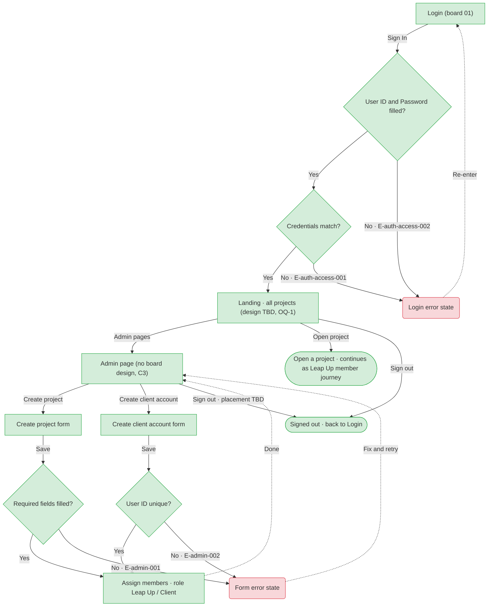
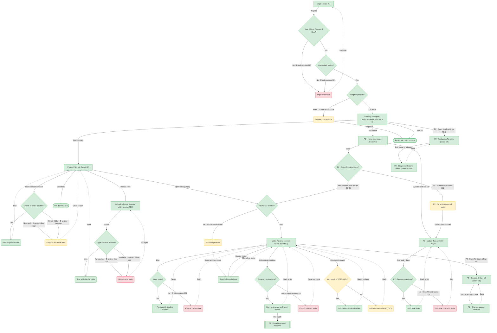
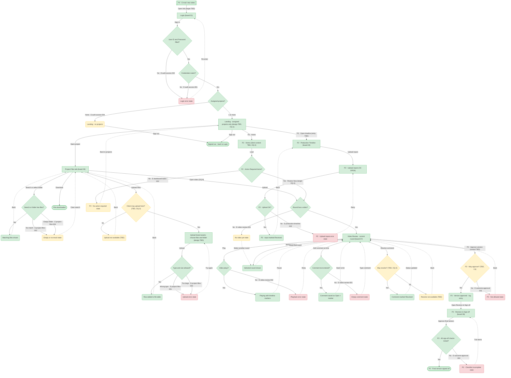

# Leap Up portal: end-to-end user journeys per role

Cross-feature view: one journey per user type, stitched from the approved per-feature user flows.
It adds no new screens or rules; every step traces to a feature flow below. Scope: **MVP + P2**
(P2 steps prefixed `P2 ·`). `OUT` (Material Library, Storyboard Review) is not drawn.

Roles: Admin, Leap Up member, Client. These are provisional (auth-access FR-010; C4 still OPEN for approver roles).
Decisions marked **TBD** are open questions drawn with both branches, not decisions.

| Source flow | Used for |
|---|---|
| [auth-access userflow](../auth-access/srs/auth-access-userflow.md) | Sign in, errors, landing, sign out (all roles) |
| [admin userflow](../admin/srs/admin-userflow.md) | Admin set-up |
| [project-files userflow](../project-files/srs/project-files-userflow.md) | Files: search, upload, download, open video |
| [video-review userflow](../video-review/srs/video-review-userflow.md) | Review rounds, comments, resolve |
| [dashboard-tasks userflow](../dashboard-tasks/srs/dashboard-tasks-userflow.md) | P2 Home, Action Required, tasks |
| [production-timeline userflow](../production-timeline/srs/production-timeline-userflow.md) | P2 timeline, Upload inputs |
| [outcome-approval userflow](../outcome-approval/srs/outcome-approval-userflow.md) | P2 version approval, change requests, sign-off |
| [email-notifications userflow](../email-notifications/srs/email-notifications-userflow.md) | P2 e-mail triggers |

## 1. Admin

## 2. Leap Up member

## 3. Client

## 4. Counts (check against Figma)

| Journey | Nodes | Edges | Return edges | Figma frame |
|---|---|---|---|---|
| Admin | 14 | 20 | 3 | `Userflow · Admin · end-to-end journey` |
| Leap Up member | 42 | 64 | 17 | `Userflow · Leap Up member · end-to-end journey` |
| Client | 48 | 71 | 19 | `Userflow · Client · end-to-end journey` |

## 5. Gaps shown in the journeys (open, not decided)

| Gap | Where | Source |
|---|---|---|
| Landing / projects list design | all roles | auth-access OQ-1, project-files OQ-2 |
| Sign-out placement | all roles | auth-access OQ-2 |
| Admin screens have no design | Admin | C3, admin OQ-1 |
| Client upload rights per folder; upload screen | Client, Leap Up | project-files OQ-3 |
| How a video opens Video Review | Leap Up, Client | project-files OQ-8 |
| Who may resolve comments | Leap Up, Client | video-review OQ-2 |
| How a new version / round is added (no control drawn; **not in the journeys**) | Leap Up | video-review OQ-3 |
| Action Required sources and Review Now target; client home | P2 | dashboard-tasks OQ-3, OQ-4 |
| Timeline entry and edit controls; Client Inputs in scope | P2 | production-timeline OQ-2, OQ-4, OQ-5 (C6) |
| Who may approve; approval control location | P2 Client | outcome-approval OQ-1, OQ-2 (C4) |
| E-mail link target; recipients per trigger | P2 | email-notifications OQ-2, OQ-3 |

Not checked by any tool: whether these journeys match how Leap Up and its clients actually work.
