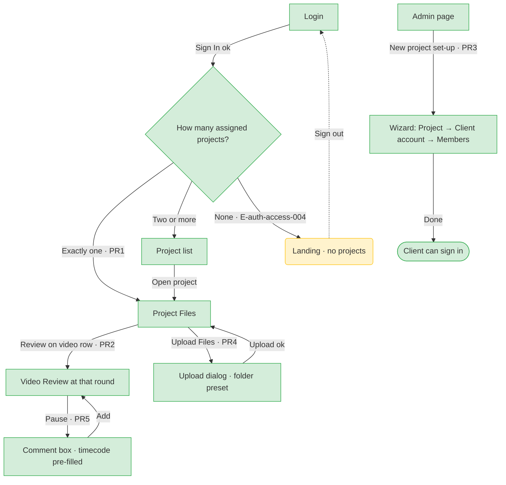

# Leap Up portal: screen designs per user journey

Hi-fi screens for every screen and state in [portal-userflow.md](portal-userflow.md), built only from the
design system (100% token / component use, 0 contrast fails, 0 layout issues per the Reqwise screen report).
Content is the board's own sample copy (`leapup-website-miro-board.md`, `Lnnn`). Error wording is **TBD**
everywhere; each error shows its code. Desktop 1440 only (mobile layouts not drawn yet).

Tags: **Board** = adapted from the agreed Miro screen · **PROPOSAL** = no board design, designed here and
labelled on the canvas "confirm with Leap Up" · **PR1–PR5** = easier-flow proposals (below the originals).

## 1. Original screens (match the requirements)

| Figma section | Frame | Journey node (role) | Scope | Basis | Requirements shown |
|---|---|---|---|---|---|
| MVP · Login | Login / Sign in | Login (all) | MVP | Board 01, L18–L170 | auth-access FR; copy L48–L170 |
| MVP · Login | … / Error | Login error state (all) | MVP | Board 01 + state | E-auth-access-001 / 002 |
| MVP · Projects | Projects / Project list | Landing · assigned / all projects | MVP | **PROPOSAL** (auth-access OQ-1) | FR-auth-access-006 |
| MVP · Projects | … / Empty | Landing · no projects | MVP | **PROPOSAL** | E-auth-access-004 |
| MVP · Project Files | Project / Files | Project Files tab (Leap Up, Client) | MVP | Board 03, L9–L179 | folders L52–L72, table L98–L179 |
| MVP · Project Files | … / Empty | Empty or no-result state | MVP | Board 03 + state | E-project-files-002 / 004 |
| MVP · Project Files | … / Upload dialog | Upload · choose files and folder | MVP | **PROPOSAL** (only the button, L83) | OQ-3 folder rights, OQ-4 limits shown as TBD |
| MVP · Project Files | … / Upload dialog / Error | Upload error state | MVP | **PROPOSAL** | E-project-files-001 / 003 |
| MVP · Video Review | Review / Video review | Video Review · current round | MVP | Board 07, L10–L193 | rounds L38–L45, player L56–L145, comments L55–L147, log L169–L193 |
| MVP · Video Review | … / No video | No video yet state | MVP | Board 07 + state | E-video-review-004 |
| MVP · Video Review | … / Playback error | Playback error state | MVP | Board 07 + state | E-video-review-002 |
| MVP · Video Review | … / Empty comment | Empty comment state | MVP | Board 07 + state | E-video-review-001 |
| MVP · Video Review | … / Approve not allowed | P2 · Not allowed state (Client) | P2 | Board 07 + state | E-outcome-approval-001; control location OQ-1; C4 |
| MVP · Admin | Admin / Admin home | Admin page | MVP | **PROPOSAL** (C3) | FR-admin-001 |
| MVP · Admin | Admin / Create project | Create project form | MVP | **PROPOSAL** (C3) | FR-admin-002…004; fields OQ-3 |
| MVP · Admin | Admin / Create account | Create client account form | MVP | **PROPOSAL** (C3) | FR-admin-005; BR-admin-001 |
| MVP · Admin | … / Error | Form error state | MVP | **PROPOSAL** | E-admin-002 (E-admin-001 named in helper) |
| MVP · Admin | Admin / Assign members | Assign members | MVP | **PROPOSAL** (C3) | FR-admin-007; BR-admin-002 / 003 |
| P2 · Home | Home / Dashboard | P2 · Home dashboard (Leap Up) | P2 | Board 02, L8–L74, L194–L231 | stats, project cards, Action Required |
| P2 · Home | … / Empty | P2 · No action required | P2 | Board 02 + state | E-dashboard-tasks-002 |
| P2 · Home | Home / Task list | P2 · Update Task List / By Project | P2 | Board 02, L82–L186 | 7 tasks as on the board |
| P2 · Home | … / Error | P2 · Task form error | P2 | Board 02 + state | E-dashboard-tasks-001; controls OQ-8 |
| P2 · Timeline and Sign-off | Timeline / Production timeline | P2 · Production Timeline (Client view) | P2 | Board 04, L197–L350 | 5 stages, 9 milestones, 5 inputs, feedback rule |
| P2 · Timeline and Sign-off | … / Upload error | P2 · Upload inputs error | P2 | Board 04 + state | E-production-timeline-002; C6 |
| P2 · Timeline and Sign-off | Approval / Sign-off | P2 · Revision & Sign-off | P2 | Board 08, L214–L365 | rounds, approvers, 4 CRs, checklist, log |
| P2 · Timeline and Sign-off | … / Checklist incomplete | P2 · Checklist incomplete | P2 | Board 08 + state | E-outcome-approval-002; C9 |

### Deviations from the board (on purpose)

1. **Logo** is a placeholder: the board's logo is an image and the client supplies the files (quote L144).
2. **Action Required** shows 2 of the board's 3 items: "Character Option A" belongs to Material Library (OUT).
3. **Sidebar** adds Project Files / Timeline / Revision & Sign-off under "711 · PROJECT" so every screen is reachable; the board shows Dashboard / Projects / Files / Outcome Review only.
4. **Approve this version** sits under the player (as in the prototype); its real location is OPEN (outcome-approval OQ-1).
5. The Sign-off state is 1160 tall instead of 1024 to fit the error alert.

### Journey nodes with no drawn screen (gaps, not dropped)

| Node | Why not drawn |
|---|---|
| Client "Upload not available (TBD)" / "Resolve not available (TBD)" | Depend on open rights questions (project-files OQ-3, video-review OQ-2) |
| New version / round upload | No control on the board (video-review OQ-3) |
| Stage / milestone edit controls; Upload inputs dialog | Controls not drawn on the board (production-timeline OQ-2; C6 OPEN) |
| Leap Up change-request form; "final version signed off" state | Not on the board; effects of sign-off OPEN (outcome-approval OQ-3, OQ-4) |
| Create-project empty-field error (E-admin-001) | Same pattern as the account error frame; named there |
| E-mail notifications | No screen (e-mail only, P2) |

## 2. Easier-flow proposals (below the originals, need Leap Up approval)

Flows: Figma page "User Flows", second row. Screens: section "PROPOSALS · PR2–PR5". None adds scope beyond the quote; each answers an open question.

| # | Proposal | Answers | Screen | Changes vs original |
|---|---|---|---|---|
| PR1 | User with exactly one project skips the project list | auth-access OQ-1 | none (flow only) | 1 click fewer for most clients |
| PR2 | **Review** on a video row opens Video Review at that round | project-files OQ-8 | Proposal / Review from row | Defines the files → review entry |
| PR3 | Admin set-up as one wizard: Project → Client account → Members | admin C3 | Proposal / Admin wizard | 3 separate forms become 3 steps; same rules E-admin-001 / 002 |
| PR4 | Upload goes into the folder that is open, with drag and drop | project-files OQ-3 | Proposal / … / Upload to open folder | No folder picking by default; rights per folder still TBD |
| PR5 | Comment takes the playhead time ("At 00:15") | video-review OQ-6 | Proposal / Timecode prefill | Timecode is never typed by hand |

## 3. Check

| Check | Result |
|---|---|
| Frames | 30 (26 original screens and states + 4 proposal screens) |
| Reqwise screen report | 0 layout issues · 0 contrast / tap-size fails · design system 100% · names 0 issues on all 30 |
| Remaining flag | Timeline "Client input status" rows reported as hand-built inputs: they are read-only status rows (label + Received / Missing badge), not text fields |
| Prototype | `prototype/portal-prototype.html` restyled with the same tokens; flows and content unchanged |

Not checked by any tool: whether these screens fit how Leap Up and its clients actually work — review with Leap Up.
