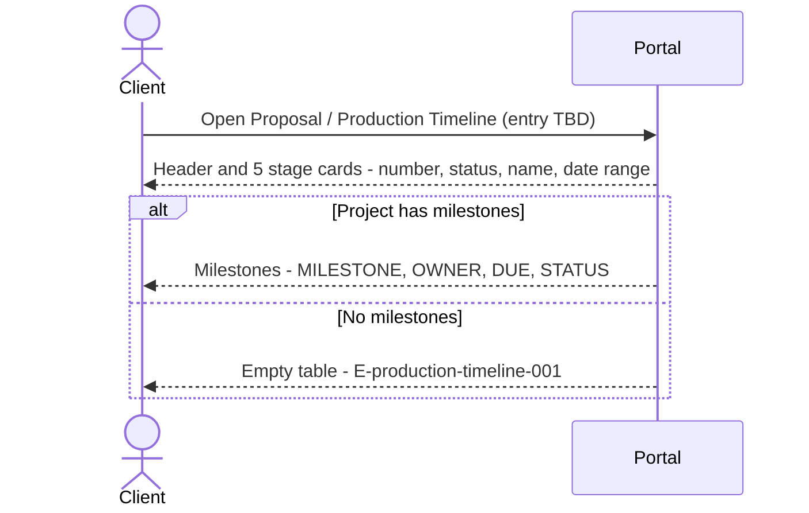
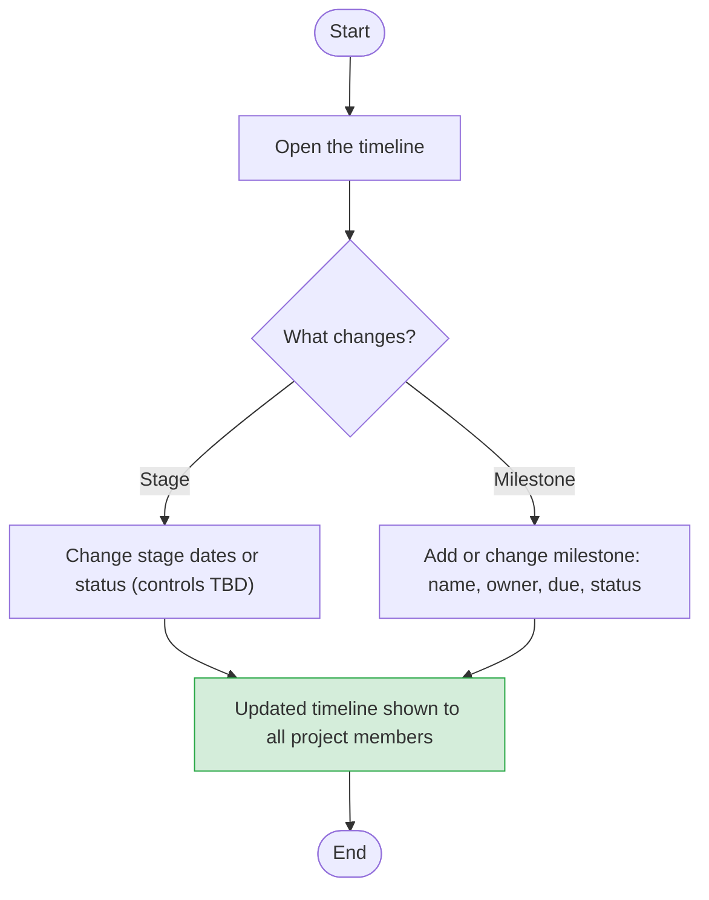
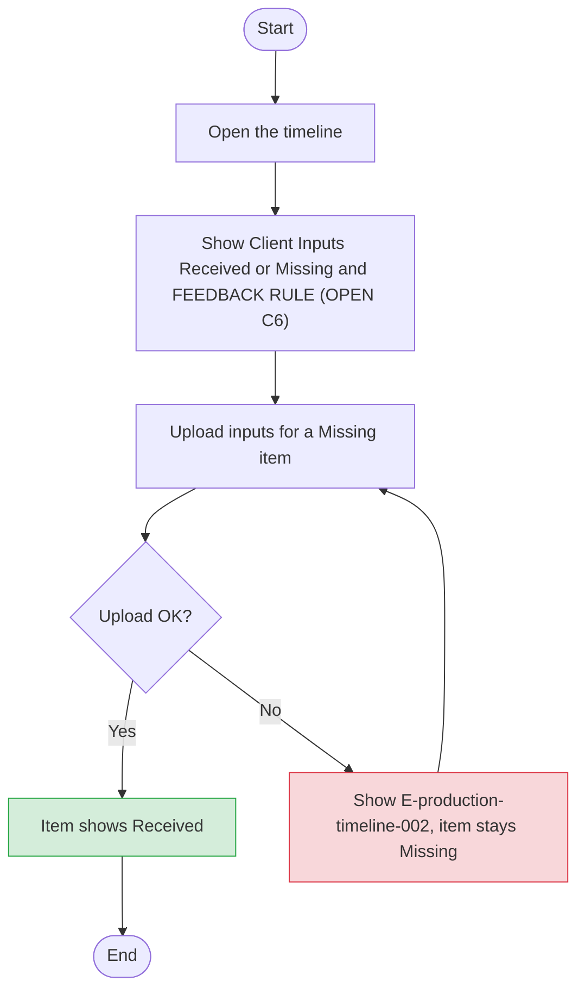

# Production Timeline — Flows

## Flow: Follow the production timeline (Sequence)

**Trigger**: Client opens the project timeline.
**Related UC**: [UC-production-timeline-01](../usecases/uc-follow-the-production-timeline.md)
**Related FR**: FR-production-timeline-001, FR-production-timeline-002, FR-production-timeline-003, FR-production-timeline-004, FR-production-timeline-005, FR-production-timeline-009
**Related E**: E-production-timeline-001

## Flow: Maintain stages and milestones (Activity)

**Trigger**: Leap Up member opens the timeline to update it.
**Related UC**: [UC-production-timeline-02](../usecases/uc-maintain-the-production-timeline.md)
**Related FR**: FR-production-timeline-003, FR-production-timeline-005, FR-production-timeline-006
**Related E**: —

## Flow: Provide missing client inputs (OPEN C6) (Activity)

**Trigger**: Client sees a Missing input.
**Related UC**: [UC-production-timeline-03](../usecases/uc-provide-client-inputs.md)
**Related FR**: FR-production-timeline-007, FR-production-timeline-008
**Related E**: E-production-timeline-002

