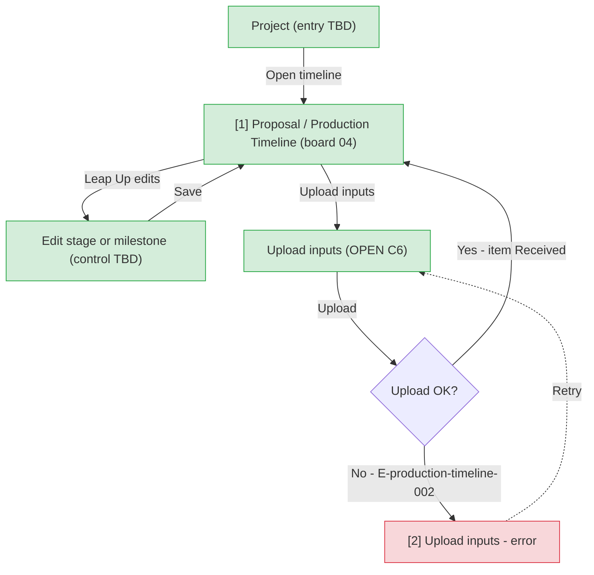

# production-timeline — User Flow

## 1. User Flow (overall)

## 2. Screens

| [#] | Slug | Screen | Purpose | Flow | Board |
|-----|------|--------|---------|------|-------|
| 1 | timeline | Proposal / Production Timeline | Stages, milestones, inputs, rule | timeline | 04, L197–L350 |
| 2 | timeline-upload-error | Upload inputs error | E-production-timeline-002 | timeline | not drawn |

## 3. Flows

| Flow-slug | Flow name | Screens | Cases covered |
|-----------|-----------|---------|---------------|
| timeline | Follow and maintain the production timeline | 1, 2 | happy 1 · error 2 |

## 3.5. Transitions

| From [#] | To [#] | Trigger | Condition |
|----------|--------|---------|-----------|
| project | 1 | Open timeline | Member |
| 1 | 1 | Edit + save | Leap Up (OQ-2) |
| 1 | 1 | Upload inputs | Success (C6) |
| 1 | 2 | Upload inputs | Failure |

## 4. Open Questions

- [ ] OQ-1: Edit controls not drawn (spec OQ-2).
