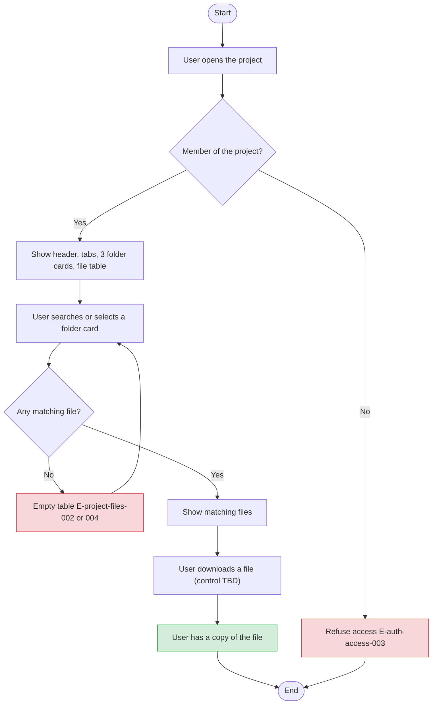
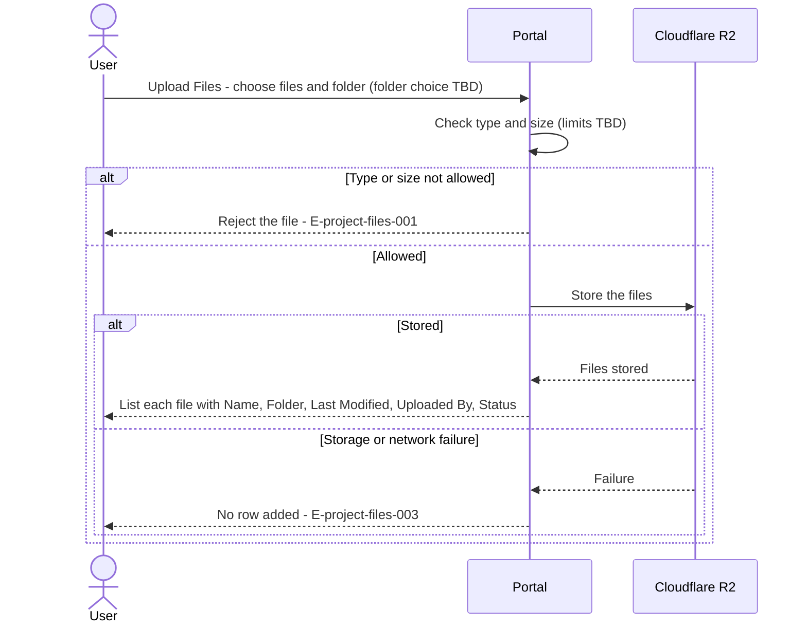

# Project Files — Flows

## Flow: Find and download a file (Activity)

**Trigger**: User opens a project to get a file.
**Related UC**: [UC-project-files-01](../usecases/uc-find-and-download-a-file.md)
**Related FR**: FR-project-files-001, FR-project-files-002, FR-project-files-003, FR-project-files-004, FR-project-files-005, FR-project-files-008, FR-project-files-009, FR-project-files-010, FR-project-files-011, FR-project-files-012, FR-project-files-013
**Related E**: E-project-files-002, E-project-files-004

## Flow: Upload files into a folder (Sequence)

**Trigger**: User presses "Upload Files" on the Project Files tab.
**Related UC**: [UC-project-files-02](../usecases/uc-upload-files.md)
**Related FR**: FR-project-files-006, FR-project-files-007, FR-project-files-008, FR-project-files-009
**Related E**: E-project-files-001, E-project-files-003

