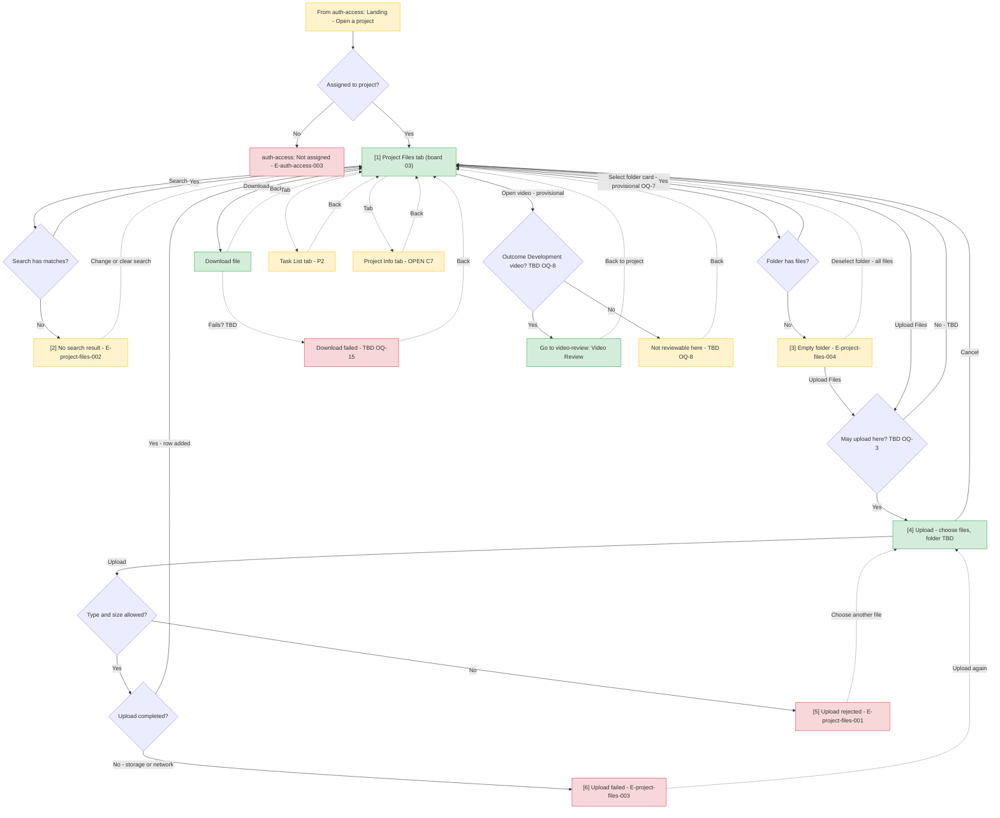

# project-files — User Flow

Revised 2026-11-22 after the MVP review ([review-2026-11-22-mvp.md](../../portal/review-2026-11-22-mvp.md), R-01, R-03,
R-04, R-13): access gate, separate empty-search / empty-folder states, upload-rights and upload-failed branches,
download failure (TBD), tabs and sidebar marked, open-video decision kept TBD. Needs re-approval.

## 1. User Flow (overall)

Display-only requirements (no flow node): FR-project-files-001 header, 003 sidebar (targets TBD, OQ-2), 004 folder
cards, 005 file table, 008 Uploaded By, 009 status pill. Sidebar Dashboard / Projects / Files (L21, L30, L46): targets
TBD (OQ-2, OQ-14). Delete / rename / replace: no flow (OQ-10).

## 2. Screens

| [#] | Slug | Screen | Purpose | Flow | Board |
|-----|------|--------|---------|------|-------|
| 1 | project-files | Project detail — Project Files tab | Folders, file table, search, upload, download | files | 03, L9–L179 |
| 2 | no-result | No search result | E-project-files-002; recovery: change the search | files | not drawn |
| 3 | empty-folder | Empty folder | E-project-files-004; recovery: Upload (if allowed) | files | not drawn |
| 4 | upload | Upload — choose files and folder | Upload input | files | not drawn (only "Upload Files" L83) |
| 5 | upload-rejected | Upload rejected | E-project-files-001 (type or size) | files | not drawn |
| 6 | upload-failed | Upload failed | E-project-files-003 (storage or network) | files | not drawn |

## 3. Flows

| Flow-slug | Flow name | Screens | Cases covered |
|-----------|-----------|---------|---------------|
| files | Share, find and download files | 1–6 | happy 1→4→1, download, open video · edge 2, 3 · error 5, 6, not assigned, download failed (TBD) · cancel on 4 |

## 3.5. Transitions

| From [#] | To [#] | Trigger | Condition |
|----------|--------|---------|-----------|
| auth-access landing | 1 | Open project | Member of project |
| auth-access landing | auth-access [5] | Open project / link | Not a member (E-auth-access-003) |
| 1 | 2 | Search | No match |
| 2 | 1 | Change or clear search | — |
| 1 | 3 | Select folder card | Folder empty (filter provisional, OQ-7) |
| 3 | 4 | Upload Files | Upload allowed (OQ-3) |
| 3 | 1 | Deselect folder | — |
| 1 | 4 | Upload Files | Upload allowed (OQ-3) |
| 4 | 1 | Upload | Valid and completed → row added |
| 4 | 5 | Upload | Type or size not allowed (E-project-files-001) |
| 4 | 6 | Upload | Storage or network failure (E-project-files-003) |
| 5, 6 | 4 | Retry | — |
| 4 | 1 | Cancel | Nothing uploaded |
| 1 | download | Download | Placement TBD (OQ-6); failure TBD (OQ-15) |
| 1 | video-review [1] | Open video | Outcome Development video (provisional, OQ-8) |

## 4. Open Questions

- [ ] OQ-1: Projects list screen (spec OQ-2).
- [ ] OQ-2: Upload screen design — only the button is on the board (spec OQ-3).
- [ ] OQ-3: Upload rights per folder and role (spec OQ-3).
- [ ] OQ-4: Open video entry and round (spec OQ-8, OQ-17).
- [ ] OQ-5: Phone layout (spec OQ-9).
