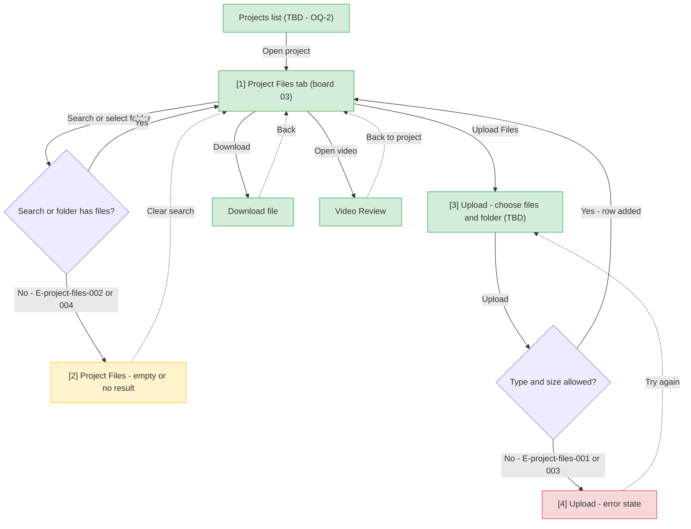

# project-files — User Flow

## 1. User Flow (overall)

## 2. Screens

| [#] | Slug | Screen | Purpose | Flow | Board |
|-----|------|--------|---------|------|-------|
| 1 | project-files | Project detail — Project Files tab | Folders, file table, search, upload | files | 03, L9–L179 |
| 2 | project-files-empty | Empty / no-result state | E-project-files-002, 004 | files | not drawn |
| 3 | upload | Upload — choose files and folder | Upload input | files | not drawn (only "Upload Files" L83) |
| 4 | upload-error | Upload error state | E-project-files-001, 003 | files | not drawn |

## 3. Flows

| Flow-slug | Flow name | Screens | Cases covered |
|-----------|-----------|---------|---------------|
| files | Share, find and download files | 1, 2, 3, 4 | happy 1→3→1, download · edge 2 · error 4 |

## 3.5. Transitions

| From [#] | To [#] | Trigger | Condition |
|----------|--------|---------|-----------|
| list | 1 | Open project | Member of project |
| 1 | 2 | Search / folder | No match / empty |
| 1 | 3 | Upload Files | Upload allowed (OQ-3) |
| 3 | 1 | Upload | Valid → row added |
| 3 | 4 | Upload | Invalid or failed |
| 1 | download | Download | — |
| 1 | Video Review | Open video | Outcome video (OQ-8) |

## 4. Open Questions

- [ ] OQ-1: Projects list screen (spec OQ-2).
- [ ] OQ-2: Upload screen design — only the button is on the board (spec OQ-3).
