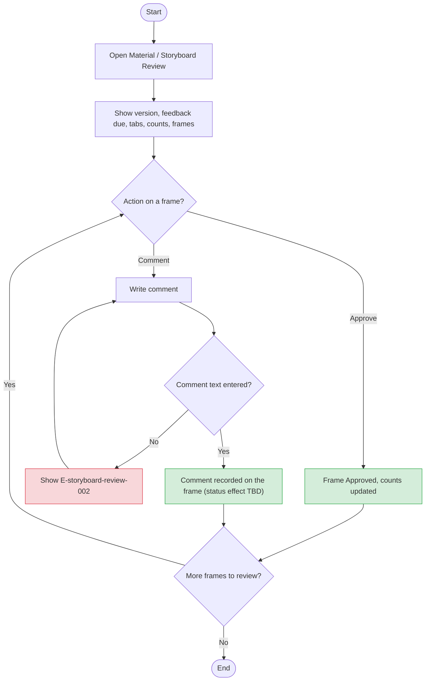
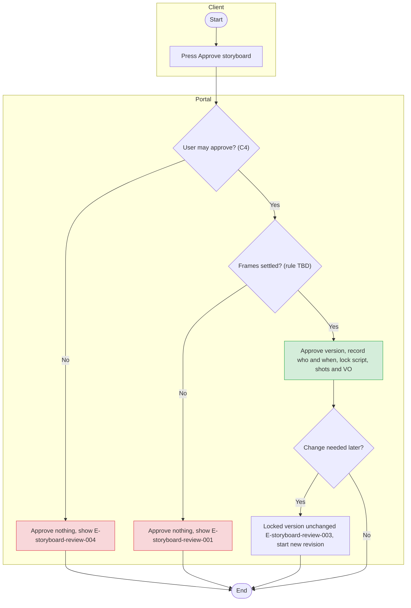

# Storyboard Review — Flows

## Flow: Review storyboard shots (OUT) (Activity)

**Trigger**: Client opens a storyboard version in Client Review.
**Related UC**: [UC-storyboard-review-01](../usecases/uc-review-storyboard-shots.md)
**Related FR**: FR-storyboard-review-001, FR-storyboard-review-002, FR-storyboard-review-003, FR-storyboard-review-004, FR-storyboard-review-005, FR-storyboard-review-006, FR-storyboard-review-007, FR-storyboard-review-008, FR-storyboard-review-011, FR-storyboard-review-012
**Related E**: E-storyboard-review-002

## Flow: Approve and lock the storyboard (OUT) (Activity)

**Trigger**: Client presses "Approve storyboard".
**Related UC**: [UC-storyboard-review-02](../usecases/uc-approve-and-lock-the-storyboard.md)
**Related FR**: FR-storyboard-review-009, FR-storyboard-review-010
**Related E**: E-storyboard-review-001, E-storyboard-review-003, E-storyboard-review-004

