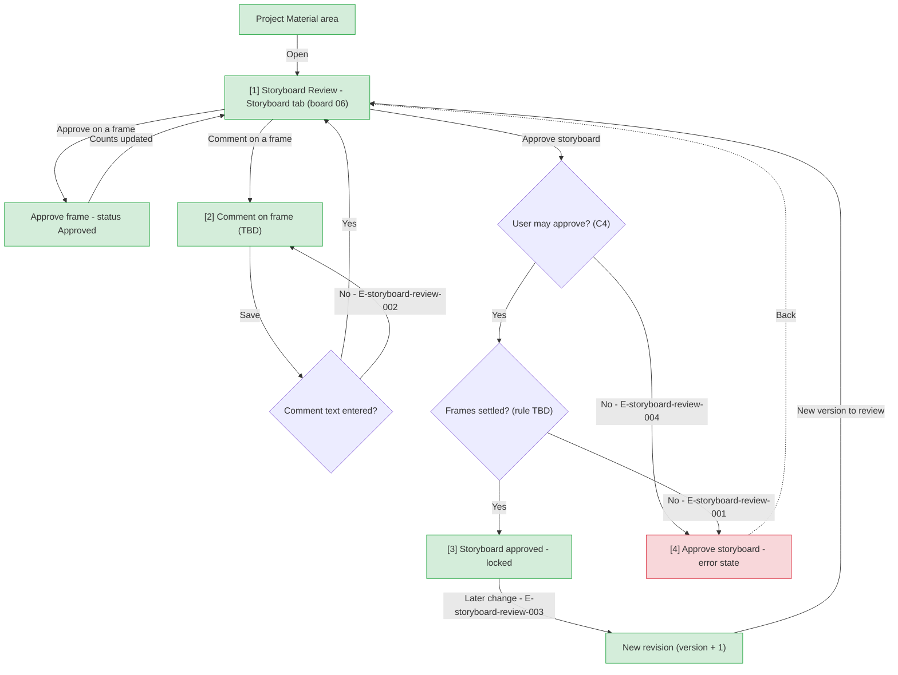

# storyboard-review — User Flow

## 1. User Flow (overall)

## 2. Screens

| [#] | Slug | Screen | Purpose | Flow | Board |
|-----|------|--------|---------|------|-------|
| 1 | storyboard | Storyboard Review — Storyboard tab | Version, counts, frames, lock notice | storyboard | 06, L425–L479 |
| 2 | frame-comment | Comment on a frame | Frame feedback | storyboard | button only (L456) |
| 3 | storyboard-approved | Storyboard approved (locked) | After Approve storyboard | storyboard | not drawn |
| 4 | storyboard-approve-error | Approve storyboard — error | E-storyboard-review-001 / 004 | storyboard | not drawn |

## 3. Flows

| Flow-slug | Flow name | Screens | Cases covered |
|-----------|-----------|---------|---------------|
| storyboard | Review and approve a storyboard version | 1–4 | happy 1→3 · error 4 · new revision |

## 3.5. Transitions

| From [#] | To [#] | Trigger | Condition |
|----------|--------|---------|-----------|
| entry | 1 | Open | Member |
| 1 | 1 | Approve frame | — |
| 1 | 2 | Comment | — |
| 1 | 3 | Approve storyboard | Allowed, frames settled (rule TBD) |
| 1 | 4 | Approve storyboard | Not allowed or frames not settled |
| 3 | 1 | Later change | New revision |

## 4. Open Questions

- [ ] OQ-1: Script and Voice & Music tabs not drawn (spec OQ-2).
