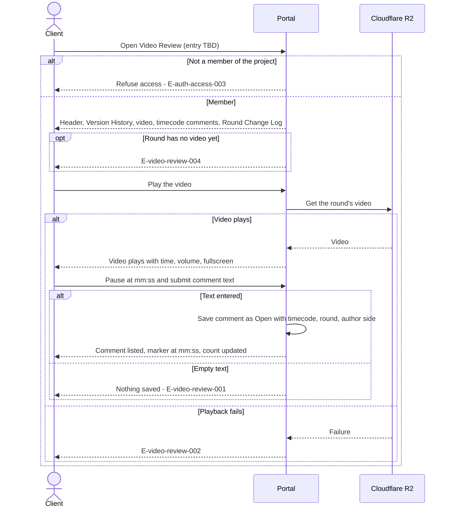
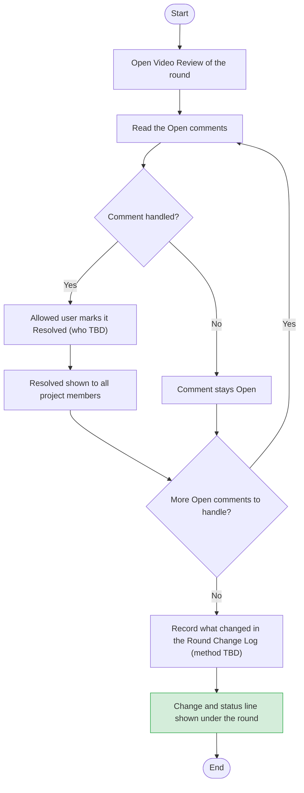
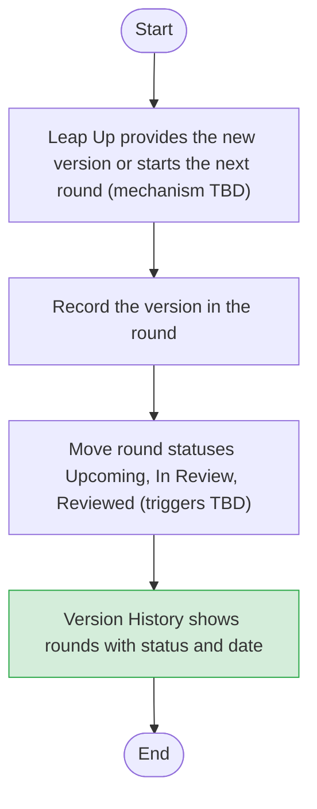

# Video Review — Flows

## Flow: Review a round with timecoded comments (Sequence)

**Trigger**: Client opens Video Review for the current round.
**Related UC**: [UC-video-review-01](../usecases/uc-review-a-round-with-timecoded-comments.md)
**Related FR**: FR-video-review-001, FR-video-review-002, FR-video-review-003, FR-video-review-004, FR-video-review-005, FR-video-review-006, FR-video-review-007, FR-video-review-008, FR-video-review-013, FR-video-review-014, FR-video-review-015
**Related E**: E-video-review-001, E-video-review-002, E-video-review-003, E-video-review-004

## Flow: Resolve comments and log the round's changes (Activity)

**Trigger**: Leap Up member opens the round to handle feedback.
**Related UC**: [UC-video-review-02](../usecases/uc-resolve-comments-and-log-changes.md)
**Related FR**: FR-video-review-009, FR-video-review-012
**Related E**: —

## Flow: Add a new version and start the next round (Activity)

**Trigger**: Leap Up has a new version after feedback.
**Related UC**: [UC-video-review-03](../usecases/uc-start-the-next-round.md)
**Related FR**: FR-video-review-003, FR-video-review-010, FR-video-review-011, FR-video-review-013
**Related E**: E-video-review-004

