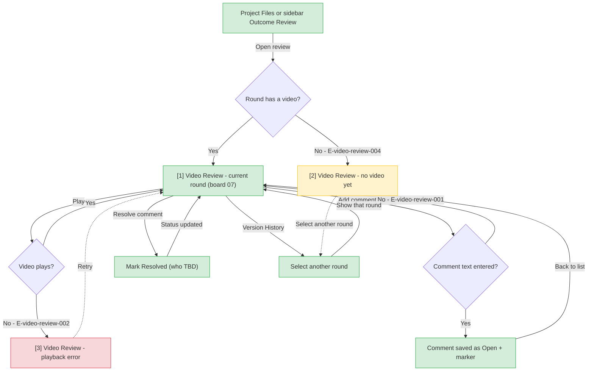

# video-review — User Flow

## 1. User Flow (overall)

## 2. Screens

| [#] | Slug | Screen | Purpose | Flow | Board |
|-----|------|--------|---------|------|-------|
| 1 | video-review | Video Review | Player, markers, comments, rounds, log | review | 07, L10–L193 |
| 2 | video-review-no-video | No video in round | E-video-review-004 | review | not drawn |
| 3 | video-review-error | Playback error | E-video-review-002 | review | not drawn |

## 3. Flows

| Flow-slug | Flow name | Screens | Cases covered |
|-----------|-----------|---------|---------------|
| review | Review a round with timecoded comments | 1, 2, 3 | happy 1 (comment, resolve, switch round) · edge 2 · error 3 |

## 3.5. Transitions

| From [#] | To [#] | Trigger | Condition |
|----------|--------|---------|-----------|
| entry | 1 | Open review | Round has a video |
| entry | 2 | Open review | No video yet |
| 1 | 3 | Play | Video fails |
| 1 | 1 | Add comment | Text entered → Open comment + marker |
| 1 | 1 | Resolve | Allowed role (OQ-2) |
| 1 | 1 | Select round | Version History |

## 4. Open Questions

- [ ] OQ-1: Upload of a new version/round — no control on board 07 (spec OQ-3).
