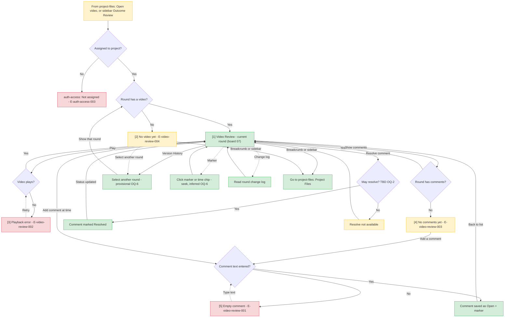

# video-review — User Flow

Revised 2026-11-22 after the MVP review ([review-2026-11-22-mvp.md](../../portal/review-2026-11-22-mvp.md), R-01, R-03,
R-06): access gate, exit via breadcrumb / sidebar, a selected round goes through the "has a video?" check, empty-comment
and no-comments states, resolve permission kept TBD, change-log and marker-click nodes. Needs re-approval.

## 1. User Flow (overall)

No flow yet (TBD, not silently dropped): FR-video-review-010 new version / next round (OQ-3 — no control on board 07),
FR-video-review-011 round status triggers (OQ-4), FR-video-review-012 who records the change log (OQ-5). Commenting on a
past round, an Upcoming round or a replaced version: TBD (OQ-11). Others' changes without realtime: TBD (OQ-14).

## 2. Screens

| [#] | Slug | Screen | Purpose | Flow | Board |
|-----|------|--------|---------|------|-------|
| 1 | video-review | Video Review | Player, markers, comments, rounds, log | review | 07, L10–L193 |
| 2 | video-review-no-video | No video in round | E-video-review-004; Upcoming round, no player | review | not drawn |
| 3 | video-review-error | Playback error | E-video-review-002; Retry | review | not drawn |
| 4 | video-review-no-comments | No comments yet | E-video-review-003; Add a comment | review | not drawn |
| 5 | video-review-empty-comment | Empty comment | E-video-review-001; input stays | review | not drawn |

## 3. Flows

| Flow-slug | Flow name | Screens | Cases covered |
|-----------|-----------|---------|---------------|
| review | Review a round with timecoded comments | 1–5 | happy 1 (comment, resolve, switch round, marker, change log, exit) · edge 2, 4, resolve not available · error 3, 5, not assigned |

## 3.5. Transitions

| From [#] | To [#] | Trigger | Condition |
|----------|--------|---------|-----------|
| entry | 1 | Open review | Member of project, round has a video |
| entry | auth-access [5] | Open review / link | Not a member (E-auth-access-003) |
| entry | 2 | Open review | No video yet |
| 1 | 3 | Play | Video fails |
| 3 | 1 | Retry | Plays |
| 1 | 4 | Show comments | Round has no comments |
| 1, 4 | 1 | Add comment | Text entered → Open comment + marker |
| 1, 4 | 5 | Add comment | Empty text |
| 1 | 1 | Resolve | Allowed role (OQ-2); otherwise "not available" |
| 1, 2 | 1 or 2 | Select round | Version History (provisional, OQ-6) → has a video? |
| 1, 2 | project-files [1] | Breadcrumb / sidebar | — (board L10, L23–L51) |

## 4. Open Questions

- [ ] OQ-1: Upload of a new version/round — no control on board 07 (spec OQ-3).
- [ ] OQ-2: Who may resolve (spec OQ-2).
- [ ] OQ-3: Comments on past / no-video rounds (spec OQ-11).
- [ ] OQ-4: Phone layout (spec OQ-8).
